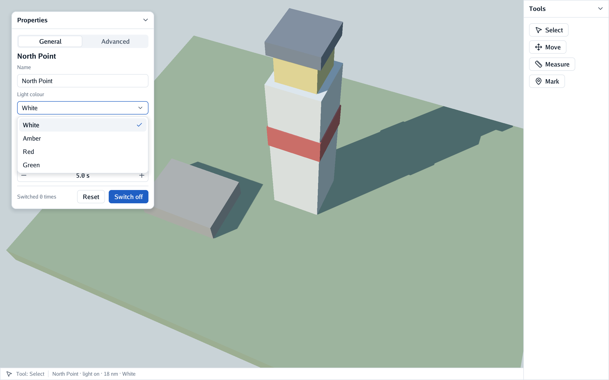
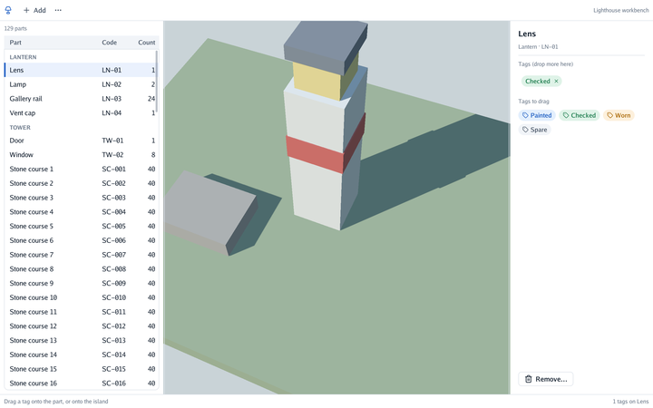
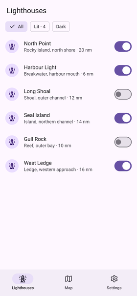
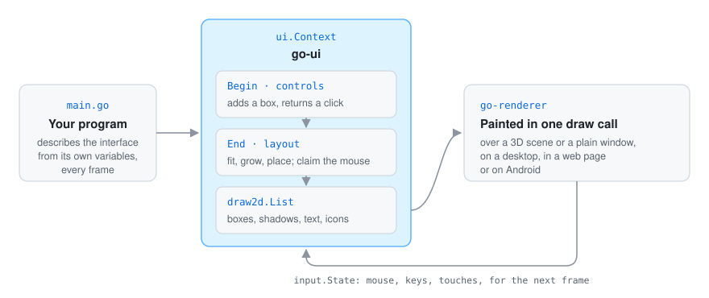

<p align="center"></p>

<div align="center">

# Go UI

**Immediate-mode interfaces in Go, drawn over a [Go Renderer](https://github.com/akrck02/go-renderer) view.**
Panels, buttons, tables and fields on top of a 3D scene, or a whole desktop application with no 3D
at all. Every frame your program describes the interface again from its own variables, and each
control tells you what happened to it.

[](go.mod)


[](LICENSE)

</div>

## 🤖 AI disclosure

I write most of my code by hand, so I want to be clear about where AI was used here.

- **Written by an AI assistant (Claude, by Anthropic) under my direction, since October 2026:**
  all of it so far: the context, the layout, the controls, the theme, the window (and its choice of
  Metal or OpenGL, and its web, Android and Nintendo 3DS versions), the examples and the docs, the
  theme's design tokens, keyboard focus, the test windows (`uitest`) and driving a window by
  script (`uidrive`).

Commits made with AI carry a `Co-Authored-By: Claude` line.

**Status: pending thorough review.**

> ⚠️ **Warning:** an educational experiment, **not suitable for production use**. APIs will
> break.

---

<p align="center">
<picture>
  <source media="(prefers-color-scheme: dark)" srcset="docs/images/hero-dark.png">
  
</picture>
</p>

## ✨ What it looks like

<table>
<tr>
<th width="33%">Over a 3D scene</th>
<th width="33%">An editor around a view</th>
<th width="33%">On a phone</th>
</tr>
<tr>
<td>
<picture>
  <source media="(prefers-color-scheme: dark)" srcset="docs/images/example-dark.png">
  
</picture>
</td>
<td>
<picture>
  <source media="(prefers-color-scheme: dark)" srcset="docs/images/workbench-dark.png">
  
</picture>
</td>
<td align="center">
<picture>
  <source media="(prefers-color-scheme: dark)" srcset="docs/images/mobile-dark.png">
  
</picture>
</td>
</tr>
<tr>
<td>Panels you drag and fold, selects, sliders and number fields; the camera keeps the drags the interface does not take.</td>
<td>Tables, menus, sheets, drag and drop onto the scene, and columns resized by their edge.</td>
<td>The same code in a window, a web page or an Android app, with touch, the on-screen keyboard and TalkBack.</td>
</tr>
<tr>
<td colspan="3" align="center">A light and a dark theme, and a window that draws only when something changes: idle, it uses next to no processor.</td>
</tr>
</table>

## 🚀 Quick start

```go
interfaceContext, _ := ui.New()
world.Overlay.Drawing = interfaceContext.Drawing()

update := func(world *scene.Scene, state *input.State, step float64) {
	interfaceContext.Begin(state)
	interfaceContext.Panel("Lighthouse", func() {
		interfaceContext.Heading(light.Name)
		if interfaceContext.PrimaryButton("Switch on") {
			light.On = true
		}
	})
	interfaceContext.End()
}
viewer.Run(world, options, "Lighthouse", update, 0)
```

Tab, Enter and Space stay with the scene until the interface is given the keyboard; an
application that is only an interface sets `KeyboardNavigation = ui.Always`
([who has the keyboard](docs/5-components/10-the-keyboard.md)).

Try the examples (they need a display, and OpenGL 4.1 or Metal):

```bash
go run ./cmd/app                      # a desktop application, no 3D (-dark for the dark theme)
go run ./cmd/scene-app                # the same kind of layout around a 3D view
go run ./cmd/plan-editor              # place huts on an island's map: editing a 3D scene
go run ./cmd/workbench                # a grouped table, chips, a menu, a sheet, drag and drop
go run ./cmd/example                  # a panel over a scene; -dark for the dark theme
go run ./cmd/example -capture shot.png
GOOS=js GOARCH=wasm go build -o web/app.wasm ./cmd/app   # the register in a web page: docs/web.md
cmd/mobile/build-apk.sh mobile.apk    # a phone-sized example on Android: docs/android.md
go test ./...
```

[More on getting started →](docs/4-guides/1-getting-started.md)

## 🔍 How it works

<p align="center">
  
</p>

There are no button objects to create and keep: showing something is an `if`, a list is a `for`,
and the interface holds none of your data, so it can never show a stale value. Layout happens at
`End`, once the whole tree is known, and the result is one `draw2d.List` that Go Renderer paints.
[More on a frame →](docs/4-guides/1-getting-started.md#a-frame)

## 📚 Documentation

New here? Start with the [overview](docs/1-overview.md), then [get started](docs/2-get-started.md), [the quest](docs/3-the-quest/0-the-quest.md), [the components one by one](docs/5-components/0-components.md) and [the reference](docs/6-reference/0-reference.md).

| | |
|---|---|
| [Getting started](docs/4-guides/1-getting-started.md) | A frame in immediate mode, ids and scopes, the examples, how it is drawn. |
| [Layout](docs/4-guides/2-layout.md) | Boxes, how sizes and positions are worked out, and how to ask for a layout. |
| [Controls](docs/4-guides/3-controls.md) | Text, buttons, choices, lists, chips, pictures, tooltips, motion. |
| [Panels and layers](docs/4-guides/4-panels-and-layers.md) | Panels, the screen, popups, menus, sheets, modals and overlays. |
| [Tables, dragging and resizing](docs/4-guides/5-tables-and-dragging.md) | Grouped tables, drag and drop onto the scene, columns resized by their edge. |
| [Text fields](docs/4-guides/6-text-fields.md) | Typing, selecting, the clipboard, undo, Tab, and phones' keyboards. |
| [Mouse, keyboard and touch](docs/4-guides/7-input.md) | Which control gets the pointer, keeping the camera out of the way, fingers. |
| [Themes](docs/4-guides/8-themes.md) | The tokens every control reads. |
| [Screen readers](docs/4-guides/9-screen-readers.md) | How a screen reader reads a Go UI program. |
| [A window of its own](docs/4-guides/10-desktop.md) · [web](docs/7-platforms/1-web.md) · [Android](docs/7-platforms/2-android.md) · [3DS](docs/7-platforms/3-3ds.md) | Interfaces without a scene, Metal or OpenGL, a browser, a phone, a console. |
| [Performance and battery](docs/8-project/1-performance-audit.md) | What an idle and a busy interface cost, measured. |

## Licence

MIT, see [LICENSE](LICENSE). `cmd/mobile` embeds the Roboto typeface (SIL Open Font License,
licence in `cmd/mobile/fonts`).
