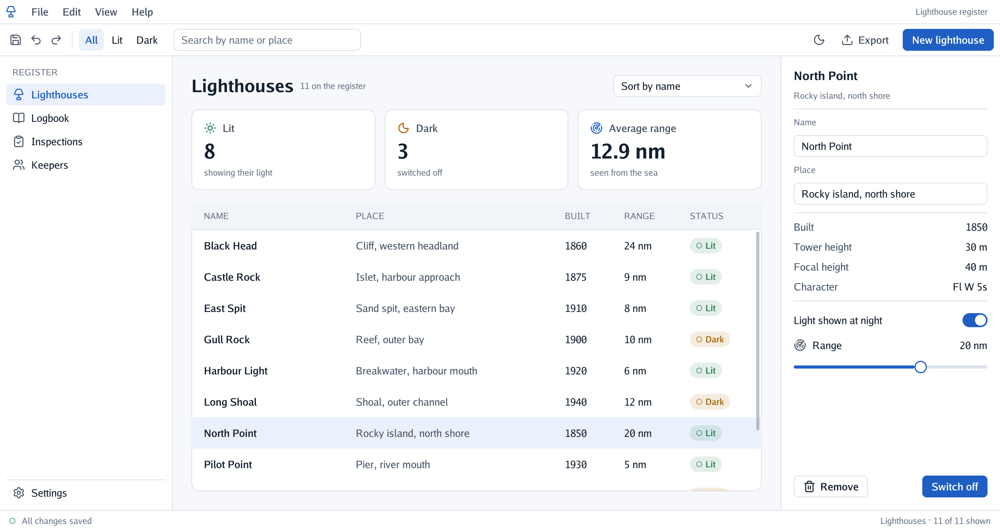

<p align="center"></p>

# Welcome to Go UI 👋

**Go UI makes the parts of a program you click and type in**: buttons, panels, lists, forms, menus. Over a 3D scene, or as a whole application in a window, a web page or a phone.

<p align="center"></p>

A program made with Go UI **describes its whole screen again many times a second** from its own data (*a title, then a button, then a list of these things*), and Go UI draws it and tells the program what was clicked. So the screen can never show something out of date.

## Is it for me?

- ✅ You write Go and want **buttons and panels** over a Go Renderer scene.
- ✅ You want a **desktop application** in Go, that also runs in a web page and on Android.
- ✅ You are **learning** how interfaces are made.
- ❌ You want a ready-made app without programming: Go UI is for building them.

## Where to start

Pick the line that sounds like you.

| If you… | Read | Time |
|---|---|---|
| just want to **see** what it looks like | [Try it without writing code](#try-it-without-writing-code) | 2 min |
| are **new** to it and want to install it | [Get started](2-get-started.md) | 15 min |
| want to **learn** step by step | 🏴‍☠️ [The quest](3-the-quest/0-the-quest.md): a register of lighthouses, in 7 levels | 2 h |
| want to know **how something works** (layout, text fields, themes) | [The guides](4-guides/1-getting-started.md) | — |
| want to use **one control** (a button, a table, a sheet) | [Components](5-components/0-components.md): each one with real examples | — |
| are **looking up** a method or an option | [The reference](6-reference/0-reference.md) | — |

## Try it without writing code

With Go installed and the projects copied (see [Get started](2-get-started.md)), these open finished examples:

```sh
go run ./cmd/app          # a desktop application (add -dark for the dark theme)
go run ./cmd/example      # panels over a 3D island
go run ./cmd/workbench    # a table, chips, a menu, drag and drop
```

## All the pages, in reading order

The menu on the left (or the files in `docs/`) follows this order.

**Start**

- [Overview](1-overview.md): this page
- [Get started](2-get-started.md): install, the examples, your first interface

**Learn**

- [The quest](3-the-quest/0-the-quest.md): seven levels that build a register of lighthouses

**Understand**

The guides, one subject each:

- [Getting started](4-guides/1-getting-started.md): a frame, ids and scopes, how it is drawn
- [Layout](4-guides/2-layout.md): boxes, `Fit`, `Grow`, `Share`, how sizes are worked out
- [Controls](4-guides/3-controls.md): text, buttons, choices, lists, grids, chips, painting
- [Panels and layers](4-guides/4-panels-and-layers.md): panels, popups, menus, sheets, modals
- [Tables, dragging and resizing](4-guides/5-tables-and-dragging.md)
- [Text fields](4-guides/6-text-fields.md): typing, selecting, focus, a phone's keyboard
- [Mouse, keyboard and touch](4-guides/7-input.md)
- [Themes](4-guides/8-themes.md): the tokens, light and dark
- [Screen readers](4-guides/9-screen-readers.md)
- [A window of its own](4-guides/10-desktop.md): interfaces without a scene
- [Testing an interface](4-guides/11-testing-an-interface.md): `go test` presses, types and looks, with no display
- [Driving a window](4-guides/12-driving-a-window.md): scripts that play a demo, a tutorial or a replay in a real window, and tests on the device

**Use**

- [Components](5-components/0-components.md): every control, with examples and pictures

**Reference**

- [The reference](6-reference/0-reference.md): the context's methods by purpose, every type

**Platforms**

- [In a web browser](7-platforms/1-web.md)
- [On Android](7-platforms/2-android.md)
- [On the Nintendo 3DS](7-platforms/3-3ds.md)

**The project**

- [Performance and battery audit](8-project/1-performance-audit.md)

## Words you will meet

| Word | What it means |
|---|---|
| Go | A programming language. To try these projects you install it once, from go.dev, and type `go run …` in a terminal. |
| Terminal | The window where you type commands: *Terminal* on macOS and Linux, *PowerShell* on Windows. |
| Repository | A project's folder of files, kept on GitHub. `git clone <address>` copies it to your computer. |
| Immediate mode | A way of making interfaces: every moment the program describes the whole screen again from its data, so the screen can never show something out of date. |
| Quest | The tutorial of these docs: short levels, each ending with something that works and an achievement. |

## 🚧 Not done yet

- Text does not wrap, except in a box with `Wrap`; there is one typeface, so no monospaced table
  column ([layout](4-guides/2-layout.md), [tables](4-guides/5-tables-and-dragging.md#tables)).
- On the desktop: notifications, films (`ErrVideoUnsupported`) and the system's dark theme
  ([Android](7-platforms/2-android.md)).
- In a browser: only Chromium on macOS was tried; other browsers, phones and tablets, and the
  on-screen keyboard are not ([web](7-platforms/1-web.md)).
- On Android: rotating the screen, other phones and tablets, the bars' icons following the
  program's theme, two fingers, and shadows, sky and waves in the scene ([Android](7-platforms/2-android.md#next)).

## The family

Go UI is one of a family of small projects that work together:

| Project | What it does |
|---|---|
| [Go Renderer](https://github.com/akrck02/go-renderer) | draws 3D scenes and flat interfaces |
| **Go UI** (this one) | buttons, panels and whole applications |
| [Go UI for Android](https://github.com/akrck02/go-ui-android) | Android apps that look like Android's own |
| [Go Sound](https://github.com/akrck02/go-sound) | sound and music |
| [Go Scene Builder](https://github.com/akrck02/go-scene-builder) | 3D scenes from a flat map |
| [Go Simulator](https://github.com/akrck02/go-simulator) | simulations that change a scene |
| [Go Terrain Simulator](https://github.com/akrck02/go-simulator-terrain) | ground shaped by rivers |
| [Go Climate Simulator](https://github.com/akrck02/go-simulator-climate) | weather and biomes |
| [Go Flora Simulator](https://github.com/akrck02/go-simulator-flora) | forests that grow |
| [Go Urban Simulator](https://github.com/akrck02/go-simulator-urban) | towns that grow |
| [Go Motion Simulator](https://github.com/akrck02/go-simulator-motion) | a scene that moves |
| [Go for 3DS](https://github.com/akrck02/go-3ds) | Go on the Nintendo 3DS |

> ⚠️ All of them are **educational experiments**, written with an AI assistant and pending review by their author: good for learning and playing, not for production.
