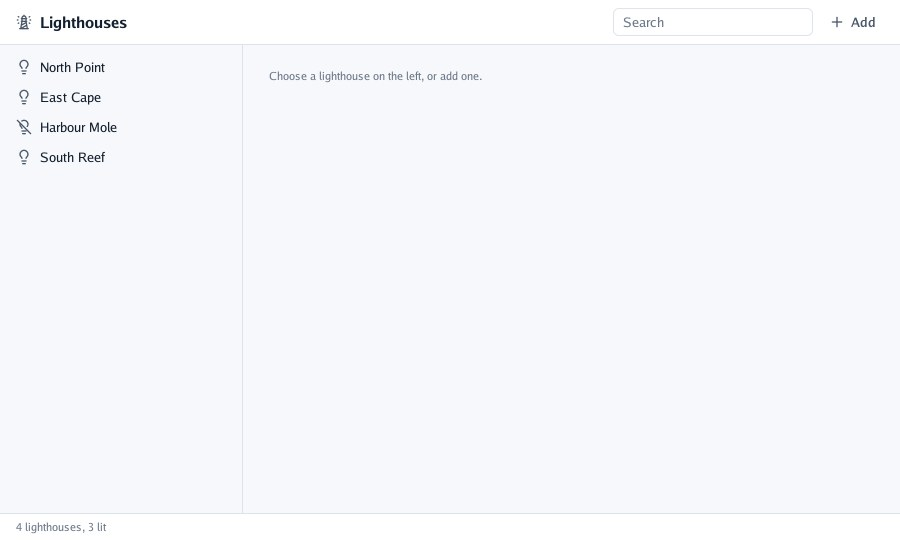
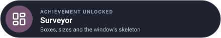

# Lesson 2: layout

In this lesson you build the skeleton of the register: a toolbar across the top, a list down the
left that can be made wider, the content in the middle and a status bar at the foot. You learn how
Go UI sizes and places **boxes**.

| Mission | Pieces | Time |
|---|---|---|
| The window's skeleton | `Box`, `Frame`, `Fit`, `Grow`, `Fixed`, `Resizable` | 15 min |

#### The idea

Layout is **packing a suitcase**: some things have a fixed size (a book), some fit what they hold (a bag of socks), and the rest grow into whatever room is left. You say which is which; Go UI does the packing at the end of the frame.



## The program's data

From here on the program keeps its state in a struct, and `build` is a method on it:

```go
// lighthouse is the program's own data: the interface shows it and changes it, and keeps none.
type lighthouse struct {
	name      string
	colour    int     // an index into colours
	rangeNM   float32 // how far the light is seen, in nautical miles
	period    float32 // seconds between flashes
	lit       bool
	foghorn   bool
	favourite bool
}

var colours = []string{"White", "Red", "Green", "Amber"}

// register is everything the program remembers between frames.
type register struct {
	lighthouses []lighthouse
	selected    int // -1 = none
	search      string
	sideWidth   float32
	removing    bool // the sheet asking before a removal is open
	added       int  // how many were added, to name new ones
}

func main() {
	options := window.Options{Title: "Lighthouse register"}
	options.RegisterFlags(flag.CommandLine)
	flag.Parse()
	options.MinWidth, options.MinHeight = 640, 400 // the smallest the layout still works at

	program := &register{
		lighthouses: []lighthouse{
			{name: "North Point", rangeNM: 18, period: 5, lit: true},
			{name: "East Cape", colour: 1, rangeNM: 12, period: 3, lit: true, foghorn: true},
			{name: "Harbour Mole", colour: 2, rangeNM: 6, period: 2},
			{name: "South Reef", colour: 3, rangeNM: 15, period: 10, lit: true},
		},
		sideWidth: 240,
	}
	if err := window.Run(options, program.build); err != nil {
		log.Fatal(err)
	}
}
```

## Boxes

Every control is a box, and boxes nest. A `ui.Layout` says how a box sizes itself and places its
children:

| Field | Means |
|---|---|
| `Direction` | `ui.Horizontal` (left to right, the default) or `ui.Vertical` (top to bottom) |
| `Width`, `Height` | How big it is: see the table below |
| `Padding` | Space inside its edges: `ui.Pad(all)`, `ui.PadXY(horizontal, vertical)` |
| `Gap` | Space between its children |
| `AlignX`, `AlignY` | `ui.Start`, `ui.Center` or `ui.End`: where children sit when there is room to spare |
| `Columns` | Above 0, a grid of that many equal columns |
| `Wrap` | Children that pass the right edge go on to a new line, like words |

| Size | Means |
|---|---|
| `ui.Fit()` | As big as its content: the default |
| `ui.Grow()` | Its content plus a share of the space left; `GrowBy(2)` takes twice the share |
| `ui.Share(weight)` | A share of the space left, starting from nothing (equal shares come out equal: table columns) |
| `ui.Fixed(pixels)` | Exactly that many layout pixels |
| `ui.Percent(0.3)` | A share of the parent |
| `….Between(minimum, maximum)` | Bounds any of them |

Sizes are worked out once the whole frame is described, at the end of the frame: a box can grow
into space that depends on boxes described after it. When the window is too narrow, growing boxes
shrink first, so fixed and fitted ones keep their size.

## The skeleton

The window is a vertical box that fills it: the toolbar, then a horizontal box that grows to take
the height left (the list and the content), then the status bar.

```go
// build describes the whole interface, in every frame.
func (program *register) build(context *ui.Context) {
	context.Box(ui.Layout{Direction: ui.Vertical, Width: ui.Grow(), Height: ui.Grow()}, func() {
		program.toolbar(context)
		context.Box(ui.Layout{Width: ui.Grow(), Height: ui.Grow()}, func() {
			program.sideList(context)
			program.details(context)
		})
		program.statusBar(context)
	})
	program.confirmRemoval(context)
}
```

### Painting a box: `Frame`

`Box` only arranges. `Frame` also paints, with a `ui.Look`: a fill, a border, rounded corners, a
shadow, a clip. Colours come from the **theme**, so the dark theme follows on its own:

```go
// statusBar sums the register up at the foot of the window.
func (program *register) statusBar(context *ui.Context) {
	lit := 0
	for _, light := range program.lighthouses {
		if light.lit {
			lit++
		}
	}
	context.Separator()
	context.Frame(ui.Layout{Width: ui.Grow(), Padding: ui.PadXY(16, 6)}, ui.Look{Fill: context.Theme.Surface}, func() {
		context.Caption(fmt.Sprintf("%d lighthouses, %d lit", len(program.lighthouses), lit))
	})
}
```

`Separator()` draws a thin line across its box. `Spacer()` takes all the free space of its row or
column, pushing what follows to the far end: the toolbar puts one between its title and its search
box.

```go
// toolbar is the bar across the top: the title, a search box and a menu to add a lighthouse.
func (program *register) toolbar(context *ui.Context) {
	theme := context.Theme
	bar := ui.Layout{Width: ui.Grow(), Padding: ui.PadXY(16, 8), Gap: 8, AlignY: ui.Center}
	context.Frame(bar, ui.Look{Fill: theme.Surface}, func() {
		context.Icon("lighthouse")
		context.Heading("Lighthouses")
		context.Spacer()
		// the search box and the Add menu come in lessons 3 and 4
	})
	context.Separator()
}
```

### A column you can resize

`Resizable` is a box with a handle on one side. Dragging it writes the new width into your
variable, between a minimum and a maximum; the program keeps the variable (and could save it).

```go
// sideList lists the lighthouses; lesson 3 makes the rows selectable.
func (program *register) sideList(context *ui.Context) {
	column := ui.Layout{Direction: ui.Vertical, Height: ui.Grow(), Padding: ui.Pad(8), Gap: 2}
	context.Resizable("side", ui.RightSide, &program.sideWidth, 180, 400, column, func() {
		for _, light := range program.lighthouses {
			context.Label(light.name)
		}
	})
}
```

And the content, for now a hint:

```go
func (program *register) details(context *ui.Context) {
	area := ui.Layout{Direction: ui.Vertical, Width: ui.Grow(), Height: ui.Grow(), Padding: ui.Pad(24), Gap: 12}
	context.Box(area, func() {
		context.Caption("Choose a lighthouse on the left, or add one.")
	})
}

func (program *register) confirmRemoval(context *ui.Context) {} // lesson 4
```

Run it and make the window narrow: the content shrinks, the list keeps its width, and the window
stops at `MinWidth`.

## Shortcuts

| Call | Is |
|---|---|
| `Row(content)` | A full-width horizontal box with the theme's gap, its children centred vertically |
| `Column(content)` | A full-width vertical box with the theme's gap |
| `Grid(columns, content)` | Rows of equal cells |
| `Spacer()`, `Separator()` | Free space; a thin line |

#### Checkpoint

A toolbar on top, the list on the left (drag its edge to widen it), a hint in the middle and the status bar at the foot; make the window narrow and the list keeps its width.



## What you learnt

- Boxes nest; a `Layout` gives a direction, sizes, padding, gaps and alignment.
- `Fit`, `Grow`, `Share`, `Fixed`, `Percent`: sizes are worked out at the end of the frame.
- `Frame` paints a box with a `Look`, in the theme's colours; `Resizable` lets the person size it.

## Bonus (optional)

Put the status bar's count on the left and the word "Saved" on the right of the same bar.

<details>
<summary>🔓 Show the solution</summary>

A `Spacer` between them pushes the second to the far end:

```go
context.Frame(ui.Layout{Width: ui.Grow(), Padding: ui.PadXY(16, 6)}, ui.Look{Fill: context.Theme.Surface}, func() {
	context.Caption(fmt.Sprintf("%d lighthouses, %d lit", len(program.lighthouses), lit))
	context.Spacer()
	context.Caption("Saved")
})
```

</details>

---

[← Lesson 1](1-immediate-mode.md) · [Lesson 3: controls and forms →](3-controls-and-forms.md)
