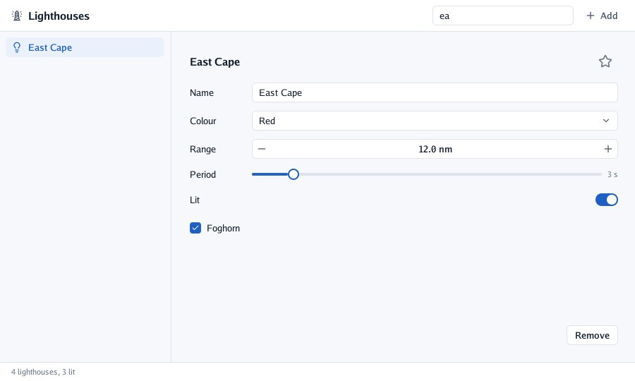

# Lesson 3: controls and forms

In this lesson the list becomes something you choose from, and the content a form that edits the
lighthouse chosen: its name, colour, range, period, whether it is lit and whether it has a foghorn.

| Mission | Pieces | Time |
|---|---|---|
| A form that edits the lighthouse chosen | `Selectable`, text and number fields, selects, sliders | 15 min |

#### The idea

Each control is a **window onto one of your variables**: the field shows `light.name` and, when you type, writes into it. The list, the heading and the status bar look through their own windows at the same variable, so they always agree.


## Choosing from a list

`Selectable(icon, label, selected)` is a row that shows whether it is chosen and returns `true`
when clicked. In a loop, each row needs an id of its own: two lighthouses could share a name, so
each row opens a **scope** with its index.

```go
// sideList lists the lighthouses that match the search; a click selects one. Its right edge can
// be dragged to make it wider.
func (program *register) sideList(context *ui.Context) {
	column := ui.Layout{Direction: ui.Vertical, Height: ui.Grow(), Padding: ui.Pad(8), Gap: 2}
	context.Resizable("side", ui.RightSide, &program.sideWidth, 180, 400, column, func() {
		for index, light := range program.lighthouses {
			if !strings.Contains(strings.ToLower(light.name), strings.ToLower(program.search)) {
				continue
			}
			context.Push(fmt.Sprint(index)) // two lighthouses may share a name: give each row its own id
			icon := "lightbulb-off"
			if light.lit {
				icon = "lightbulb"
			}
			if context.Selectable(icon, light.name, index == program.selected) {
				program.selected = index
			}
			context.Pop()
		}
	})
}
```

The search box goes in the toolbar, after the `Spacer`. A text field edits your string in place
and returns `true` on the frames it changes; here the list simply reads `program.search` at the
next frame:

```go
context.TextFieldWith("search", &program.search, ui.TextFieldOptions{Placeholder: "Search", Width: ui.Fixed(200)})
```



For thousands of rows, `List(name, layout, count, rowHeight, row)` builds only the rows in sight,
and `Table` adds a header, columns and groups ([the guide](../4-guides/5-tables-and-dragging.md#tables)).

## The form

Each control takes a **pointer** to the value it edits, and returns `true` when the person changed
it. A small helper lines the labels up in a column of their own:

```go
// field is a row of the form: a label in a column of its own width, then the control.
func field(context *ui.Context, label string, control func()) {
	context.Row(func() {
		context.Box(ui.Layout{Width: ui.Fixed(80)}, func() { context.Label(label) })
		control()
	})
}
```

```go
// details is the form of the lighthouse selected.
func (program *register) details(context *ui.Context) {
	area := ui.Layout{Direction: ui.Vertical, Width: ui.Grow(), Height: ui.Grow(), Padding: ui.Pad(24), Gap: 12}
	context.Box(area, func() {
		if program.selected < 0 {
			context.Caption("Choose a lighthouse on the left, or add one.")
			return
		}
		light := &program.lighthouses[program.selected]
		context.Row(func() {
			context.Heading(light.name)
			context.Spacer()
			favouriteButton(context, &light.favourite) // lesson 5
		})
		field(context, "Name", func() {
			context.TextFieldWith("name", &light.name, ui.TextFieldOptions{MaxLength: 40})
		})
		field(context, "Colour", func() { context.Select("colour", &light.colour, colours) })
		field(context, "Range", func() { context.NumberField("range", &light.rangeNM, 1, 30, 0.5, "%.1f nm") })
		field(context, "Period", func() {
			context.SliderStep("period", &light.period, 1, 20, 1)
			context.Caption(fmt.Sprintf("%.0f s", light.period))
		})
		context.Toggle("Lit", &light.lit)
		context.Checkbox("Foghorn", &light.foghorn)
		context.Spacer()
		context.Row(func() {
			context.Spacer()
			if context.Button("Remove") {
				program.removing = true // lesson 4 asks first
			}
		})
	})
}
```

Until lesson 5, leave out the `favouriteButton` line.

Notice what is *not* there: no "on change" handler copies the name into the list. The field writes
`light.name`, and the list, the heading and the status bar read it at the next frame.

### The controls you used

| Control | Edits | Feels like |
|---|---|---|
| `TextField(name, &text)`, `TextFieldWith(…, options)` | A `string` | Selection, the clipboard, undo, Tab to the next field; `Placeholder`, `MaxLength`, `Secret` |
| `Select(name, &index, options)` | An `int` | A field that opens its list over everything; arrows and Enter work |
| `NumberField(name, &value, minimum, maximum, step, format)` | A `float32` | − and +, drag sideways, or click and type |
| `Slider(name, &value, minimum, maximum)`, `SliderStep(…, step)` | A `float32` | Click to jump, drag, Shift for fine steps |
| `Toggle(label, &on)` | A `bool` | A settings row with a switch |
| `Checkbox(label, &on)` | A `bool` | A box to tick |
| `Tabs(name, &index, labels…)` | An `int` | A segmented row; show the tab's content with an `if` |
| `ListBox(name, layout, items, &index)` | An `int` | A scrolling list of selectable items |

The full list, with buttons, chips, images and tooltips, is in [the reference](../6-reference/0-reference.md#controls).

> 📝 **The keyboard and the 3D view.** While a field has the keyboard, go-ui *claims* it, so a 3D
> view's shortcuts do not take the letters you type ([lesson 6](6-over-a-3d-scene.md)).

#### Checkpoint

Click *East Cape*: the form shows its name, colour, range and period; rename it and the list changes as you type; *ea* in the search leaves it alone in the list.


## What you learnt

- `Selectable` rows in a loop, each in a scope of its own (`Push`, `Pop`).
- Controls edit the value they point to and return `true` when it changed.
- Every part of the screen reads the same data at every frame, so nothing needs syncing.

## Bonus (optional)

Show a warning under the range when it is above 25 nm, in the theme's warning colour.

<details>
<summary>🔓 Show the solution</summary>

```go
if light.rangeNM > 25 {
	context.Text("A range this long needs a tall tower", ui.TextStyle{Color: context.Theme.Warning})
}
```

</details>

---

[← Lesson 2](2-layout.md) · [Lesson 4: menus, sheets and notes →](4-menus-sheets-and-notes.md)
