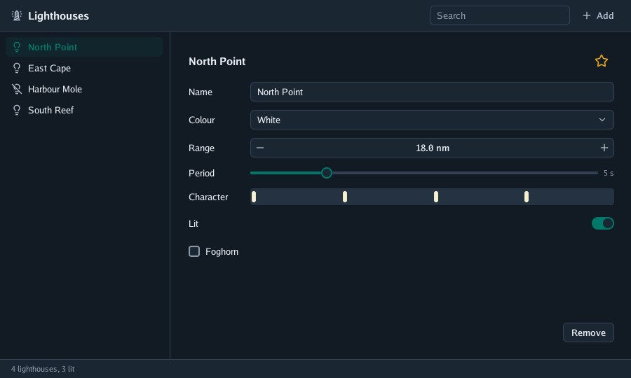
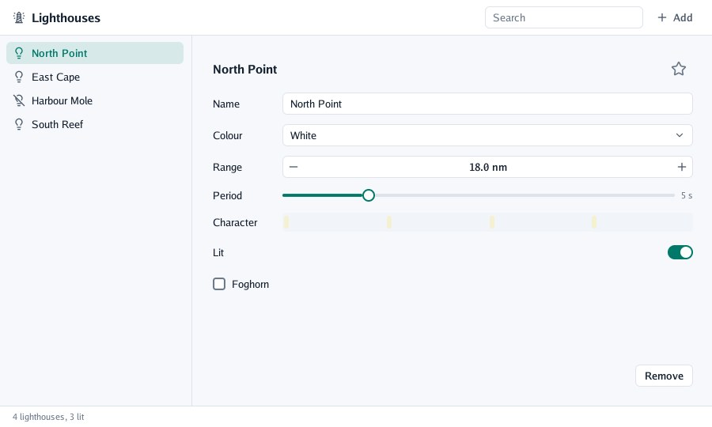
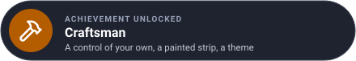

# Lesson 5: controls of your own

Go UI's controls are built from the same pieces you can use. In this lesson you make a **favourite
star** from a clickable box, tell **screen readers** what it is, **paint** a strip of your own, and
give the register a **theme** colour of its own.

| Mission | Pieces | Time |
|---|---|---|
| A favourite star, and a theme of your own | `Clickable`, `Describe`, `Paint`, `Theme` | 20 min |

#### The idea

Go UI's own buttons are made of the same **bricks** you can use: a box that reacts to the pointer, with a look for each state. And the theme is a **paint chart**: change one swatch and every wall painted with it changes.



## A clickable box

`Clickable(name, layout, looks, content)` is any box that reacts to the pointer: it is painted with
one of three `Look`s (left alone, hovered, pressed) and returns `true` when clicked. Inside, put
anything. Go UI's own buttons are made this way.

```go
// favouriteButton is a control of the program's own: a star, golden while the lighthouse is a
// favourite. A click flips it.
func favouriteButton(context *ui.Context, favourite *bool) {
	theme := context.Theme
	square := ui.Layout{Width: ui.Fixed(36), Height: ui.Fixed(36), AlignX: ui.Center, AlignY: ui.Center}
	looks := ui.Looks{
		Hovered: ui.Look{Fill: theme.Sunken, Radius: 18},
		Pressed: ui.Look{Fill: theme.Line, Radius: 18},
	}
	colour := theme.InkQuiet
	if *favourite {
		colour = draw2d.MustHex("#e8a317")
	}
	if context.Clickable("favourite", square, looks, func() {
		context.IconSized("star", 20, colour)
	}) {
		*favourite = !*favourite
	}
	// a screen reader would only hear "star": say what it is and whether it is on
	context.Describe(ui.Description{Role: ui.SwitchRole, Label: "Favourite", Checked: *favourite})
}
```

It goes in the heading row of the form, after a `Spacer` (lesson 3 already calls it).

## Screen readers

A screen reader (TalkBack on Android) speaks what is on the screen for someone who cannot see it.
Go UI works out what to say from the boxes: a button reads its text, a checkbox says whether it is
ticked. A box of your own holds only an icon, which would be read as "star". `Describe`, right
after the control, says what it really is:

| `ui.Description` field | Says |
|---|---|
| `Role` | What kind of thing: `ButtonRole`, `SwitchRole`, `CheckboxRole`, `SliderRole`, `FieldRole`… |
| `Label` | Its name |
| `Value` | What it holds |
| `Checked`, `Selected`, `Disabled` | Its state |
| `Hidden` | Leave it out: a decoration |

It costs nothing while no screen reader is on. The [guide](../4-guides/9-screen-readers.md) explains
how the screen is read.

## Painting your own shapes

When no control draws what you need, `Paint(layout, paint)` adds a box that is laid out like any
other and then handed to your function, with its final rectangle and Go Renderer's `draw2d.List`
to draw into: rounded rectangles, shadows, text, icons, pictures.

The register shows a light's *character*, a mark for every flash in twenty seconds:

```go
// flashes paints the light's character over twenty seconds: a mark for every flash.
func flashes(context *ui.Context, period float32, colour draw2d.Color) {
	theme := context.Theme
	context.Paint(ui.Layout{Width: ui.Grow(), Height: ui.Fixed(24)}, func(area draw2d.Rectangle, drawing *draw2d.List) {
		drawing.Rectangle(area, 4, theme.Sunken, draw2d.Transparent, 0)
		const seconds = 20
		for second := float32(0); second < seconds; second += period {
			x := area.X + area.Width*second/seconds
			drawing.Rectangle(draw2d.Rectangle{X: x + 2, Y: area.Y + 4, Width: 6, Height: area.Height - 8}, 3, colour, draw2d.Transparent, 0)
		}
	})
}

// lampColours are the colours a flash is painted in, by colours' order.
var lampColours = []draw2d.Color{draw2d.MustHex("#f5f0d0"), draw2d.MustHex("#d64545"), draw2d.MustHex("#3f9b5b"), draw2d.MustHex("#e8a317")}
```

```go
field(context, "Character", func() { flashes(context, light.period, lampColours[light.colour]) })
```

Coordinates are layout pixels from the window's top-left corner, like everything in Go UI.

## Themes

Every control reads its colours and sizes from `context.Theme`: surfaces, inks, lines, the primary
colour, text sizes, the height of a control, gaps, padding and corner radii. `ui.LightTheme()` is
the default and `ui.DarkTheme()` its dark twin (`-dark`, or `window.SystemPrefersDark()`). Change a
token and every control follows:

```go
func (program *register) build(context *ui.Context) {
	context.Theme.Primary = draw2d.MustHex("#00796b") // a teal of the register's own
	context.Theme.PrimaryTint = context.Theme.Primary.WithAlpha(0.12)
	…
```



| Token | Used for |
|---|---|
| `Background`, `Surface`, `Sunken` | Behind everything; panels and bars; wells and hovered controls |
| `Ink`, `InkSoft`, `InkQuiet` | Body text; secondary text and icons; hints |
| `Line`, `ControlLine` | Separators; the borders of fields and buttons |
| `Primary`, `OnPrimary`, `PrimaryTint` | The main action, the text on it, a light wash of it |
| `Positive`, `Warning`, `Danger` | States |
| `TextSize`, `HeadingSize`, `ControlHeight`, `Gap`, `Padding`, `ControlRadius`… | Sizes, in layout pixels |

## Moving things

Controls of your own can move. `context.Animate(name, target, duration)` eases a value towards a
target and asks for frames only while it moves; `context.Appear(name, duration)` eases from 0 to 1
the first time something is shown; `context.Fold(name, open, duration, layout, content)` opens a
box to its content's height and closes it to nothing.

#### Checkpoint

A star beside the name turns gold when clicked; under the period, a strip shows a mark for every flash; everything primary is teal.



## What you learnt

- `Clickable` makes any box a control, with a look for each state.
- `Describe` tells screen readers what a control of your own is.
- `Paint` draws your own shapes in a laid-out box; the theme's tokens colour and size everything.

## Bonus (optional)

Make the star grow a little while the pointer is over it, easing between the two sizes.

<details>
<summary>🔓 Show the solution</summary>

`Clickable` does not tell you whether it is hovered, but the area it had in the last frame does:
`context.Area` finds a control by its scopes and name, and `context.Pointer()` says where the
pointer is.

```go
area, found := context.Area("favourite")
pointerX, pointerY := context.Pointer()
target := float32(20)
if found && area.Contains(pointerX, pointerY) {
	target = 24
}
size := context.Animate("favourite size", target, 120*time.Millisecond)
… context.IconSized("star", size, colour) …
```

</details>

## The whole program

`main.go`:

```go
// Command register is the go-ui tutorial's program: a register of lighthouses, with a list to
// choose one, a form to edit it, a search, a menu to add one and a sheet that asks before removing.
package main

import (
	"flag"
	"fmt"
	"github.com/akrck02/go-renderer/draw2d"
	"log"
	"strings"

	ui "github.com/akrck02/go-ui"
	"github.com/akrck02/go-ui/window"
)

// lighthouse is the program's own data: the interface shows it and changes it, and keeps none.
type lighthouse struct {
	name      string
	colour    int     // an index into colours
	rangeNM   float32 // how far the light is seen, in nautical miles
	period    float32 // seconds between flashes
	lit       bool
	foghorn   bool
	favourite bool
}

var colours = []string{"White", "Red", "Green", "Amber"}

// register is everything the program remembers between frames.
type register struct {
	lighthouses []lighthouse
	selected    int // -1 = none
	search      string
	sideWidth   float32
	removing    bool // the sheet asking before a removal is open
	added       int  // how many were added, to name new ones
}

func main() {
	options := window.Options{Title: "Lighthouse register"}
	options.RegisterFlags(flag.CommandLine)
	flag.Parse()
	options.MinWidth, options.MinHeight = 640, 400 // the smallest the layout still works at

	program := &register{
		lighthouses: []lighthouse{
			{name: "North Point", rangeNM: 18, period: 5, lit: true},
			{name: "East Cape", colour: 1, rangeNM: 12, period: 3, lit: true, foghorn: true},
			{name: "Harbour Mole", colour: 2, rangeNM: 6, period: 2},
			{name: "South Reef", colour: 3, rangeNM: 15, period: 10, lit: true},
		},
		sideWidth: 240,
	}
	if err := window.Run(options, program.build); err != nil {
		log.Fatal(err)
	}
}

// build describes the whole interface, in every frame.
func (program *register) build(context *ui.Context) {
	context.Theme.Primary = draw2d.MustHex("#00796b") // a teal of the register's own
	context.Theme.PrimaryTint = context.Theme.Primary.WithAlpha(0.12)
	context.Box(ui.Layout{Direction: ui.Vertical, Width: ui.Grow(), Height: ui.Grow()}, func() {
		program.toolbar(context)
		context.Box(ui.Layout{Width: ui.Grow(), Height: ui.Grow()}, func() {
			program.sideList(context)
			program.details(context)
		})
		program.statusBar(context)
	})
	program.confirmRemoval(context)
}

// toolbar is the bar across the top: the title, a search box and a menu to add a lighthouse.
func (program *register) toolbar(context *ui.Context) {
	theme := context.Theme
	bar := ui.Layout{Width: ui.Grow(), Padding: ui.PadXY(16, 8), Gap: 8, AlignY: ui.Center}
	context.Frame(bar, ui.Look{Fill: theme.Surface}, func() {
		context.Icon("lighthouse")
		context.Heading("Lighthouses")
		context.Spacer()
		context.TextFieldWith("search", &program.search, ui.TextFieldOptions{Placeholder: "Search", Width: ui.Fixed(200)})
		context.MenuButton("plus", "Add", func() {
			if context.MenuItem("lighthouse", "Lighthouse", "") {
				program.add()
			}
			if context.MenuItem("copy", "Copy of the selected one", "") && program.selected >= 0 {
				program.lighthouses = append(program.lighthouses, program.lighthouses[program.selected])
				program.selected = len(program.lighthouses) - 1
			}
		})
	})
	context.Separator()
}

// sideList lists the lighthouses that match the search; a click selects one. Its right edge can
// be dragged to make it wider.
func (program *register) sideList(context *ui.Context) {
	column := ui.Layout{Direction: ui.Vertical, Height: ui.Grow(), Padding: ui.Pad(8), Gap: 2}
	context.Resizable("side", ui.RightSide, &program.sideWidth, 180, 400, column, func() {
		for index, light := range program.lighthouses {
			if !strings.Contains(strings.ToLower(light.name), strings.ToLower(program.search)) {
				continue
			}
			context.Push(fmt.Sprint(index)) // two lighthouses may share a name: give each row its own id
			icon := "lightbulb-off"
			if light.lit {
				icon = "lightbulb"
			}
			if context.Selectable(icon, light.name, index == program.selected) {
				program.selected = index
			}
			context.Pop()
		}
	})
}

// details is the form of the lighthouse selected.
func (program *register) details(context *ui.Context) {
	area := ui.Layout{Direction: ui.Vertical, Width: ui.Grow(), Height: ui.Grow(), Padding: ui.Pad(24), Gap: 12}
	context.Box(area, func() {
		if program.selected < 0 {
			context.Caption("Choose a lighthouse on the left, or add one.")
			return
		}
		light := &program.lighthouses[program.selected]
		context.Row(func() {
			context.Heading(light.name)
			context.Spacer()
			favouriteButton(context, &light.favourite)
		})
		field(context, "Name", func() {
			context.TextFieldWith("name", &light.name, ui.TextFieldOptions{MaxLength: 40})
		})
		field(context, "Colour", func() { context.Select("colour", &light.colour, colours) })
		field(context, "Range", func() { context.NumberField("range", &light.rangeNM, 1, 30, 0.5, "%.1f nm") })
		field(context, "Period", func() {
			context.SliderStep("period", &light.period, 1, 20, 1)
			context.Caption(fmt.Sprintf("%.0f s", light.period))
		})
		field(context, "Character", func() { flashes(context, light.period, lampColours[light.colour]) })
		context.Toggle("Lit", &light.lit)
		context.Checkbox("Foghorn", &light.foghorn)
		context.Spacer()
		context.Row(func() {
			context.Spacer()
			if context.Button("Remove") {
				program.removing = true
			}
		})
	})
}

// field is a row of the form: a label in a column of its own width, then the control.
func field(context *ui.Context, label string, control func()) {
	context.Row(func() {
		context.Box(ui.Layout{Width: ui.Fixed(80)}, func() { context.Label(label) })
		control()
	})
}

// statusBar sums the register up at the foot of the window.
func (program *register) statusBar(context *ui.Context) {
	lit := 0
	for _, light := range program.lighthouses {
		if light.lit {
			lit++
		}
	}
	context.Separator()
	context.Frame(ui.Layout{Width: ui.Grow(), Padding: ui.PadXY(16, 6)}, ui.Look{Fill: context.Theme.Surface}, func() {
		context.Caption(fmt.Sprintf("%d lighthouses, %d lit", len(program.lighthouses), lit))
	})
}

// confirmRemoval asks before a lighthouse is taken out of the register.
func (program *register) confirmRemoval(context *ui.Context) {
	if !program.removing {
		return
	}
	name := program.lighthouses[program.selected].name
	dismissed := context.Sheet("Remove lighthouse", ui.SheetOptions{}, func() {
		context.Label(fmt.Sprintf("Take %s out of the register?", name))
		context.Row(func() {
			context.Spacer()
			if context.Button("Keep it") {
				program.removing = false
			}
			if context.PrimaryButton("Remove") {
				program.remove()
				context.Toast(name+" was removed", false)
			}
		})
	})
	if dismissed {
		program.removing = false
	}
}

func (program *register) add() {
	program.added++
	program.lighthouses = append(program.lighthouses, lighthouse{name: fmt.Sprintf("New lighthouse %d", program.added), rangeNM: 10, period: 5})
	program.selected = len(program.lighthouses) - 1
	program.search = ""
}

func (program *register) remove() {
	program.lighthouses = append(program.lighthouses[:program.selected], program.lighthouses[program.selected+1:]...)
	program.selected = min(program.selected, len(program.lighthouses)-1)
	program.removing = false
}
```

`favourite.go` and `flashes.go` are above, each with `package main` and its imports
(`github.com/akrck02/go-renderer/draw2d` and `ui "github.com/akrck02/go-ui"`).

---

[← Lesson 4](4-menus-sheets-and-notes.md) · [Lesson 6: over a 3D scene →](6-over-a-3d-scene.md)
