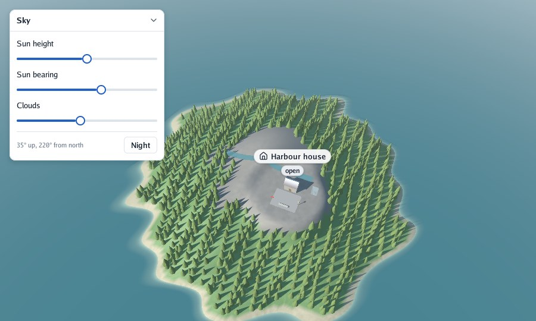
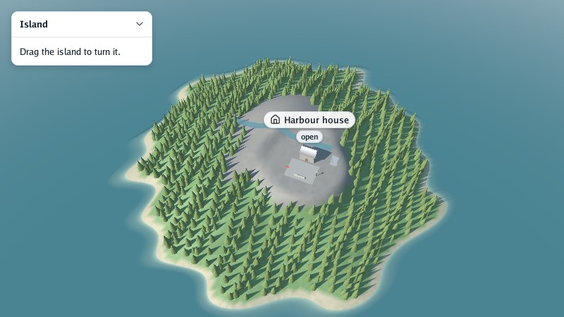
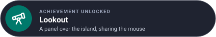

# Lesson 6: over a 3D scene

Go UI was made to draw interfaces over [Go Renderer](https://github.com/akrck02/go-renderer)'s
scenes. In this lesson you put a panel over an island that moves the sun and the clouds, and learn
how the interface and the camera share the mouse.

| Mission | Pieces | Time |
|---|---|---|
| A panel that moves the sun over an island | `viewer.Run`, claims, `Options.Scene` | 15 min |

#### The idea

The interface and the camera share one mouse, like **two people and one remote control**: whoever the pointer is over has it. When it is over a panel, Go UI claims it, and the camera gets only what was left.



There are two ways in:

| | `viewer.Run` (Go Renderer) | `window.Options.Scene` (Go UI) |
|---|---|---|
| The cameras | The viewer's: orbit, walking, map, its keys and flags | Yours: a `camera.Orbit` or anything that fills a `models.Camera` |
| Runs on | The desktop | The desktop, a web page and Android |
| Good for | Tools over a scene: editors, inspectors, simulations | Applications with a scene inside: a phone app with a map |

## With the viewer

The viewer calls your update function at every step; Go UI's frame goes inside it, between `Begin`
and `End`. You make the context yourself with `ui.New()`, and hand its drawing to the scene's
overlay once:

```go
// An interface over a go-renderer scene: a panel that moves the sun and the clouds over the sample
// island.
package main

import (
	"flag"
	"fmt"
	"log"
	"math"

	"github.com/akrck02/go-renderer/graphics"
	"github.com/akrck02/go-renderer/input"
	"github.com/akrck02/go-renderer/scene"
	"github.com/akrck02/go-renderer/scene/sample"
	"github.com/akrck02/go-renderer/viewer"
	ui "github.com/akrck02/go-ui"
)

func main() {
	options := viewer.DefaultOptions()
	options.RegisterFlags(flag.CommandLine)
	flag.Parse()

	context, err := ui.New()
	if err != nil {
		log.Fatal(err)
	}
	world := sample.Island()
	world.Overlay.Drawing = context.Drawing() // go-renderer paints what go-ui lays out

	elevation, azimuth := float32(35), float32(220) // degrees
	clouds := world.Environment.EffectiveSky().Clouds.Coverage

	update := func(world *scene.Scene, state *input.State, step float64) {
		context.Begin(state)
		context.PanelWith("Sky", ui.PanelOptions{X: 16, Y: 16, Width: ui.Fixed(260)}, func() {
			context.Label("Sun height")
			context.Slider("elevation", &elevation, -20, 90)
			context.Label("Sun bearing")
			context.Slider("azimuth", &azimuth, 0, 360)
			context.Label("Clouds")
			context.Slider("clouds", &clouds, 0, 1)
			context.Separator()
			context.Row(func() {
				context.Caption(fmt.Sprintf("%.0f° up, %.0f° from north", elevation, azimuth))
				context.Spacer()
				if context.Button("Night") {
					elevation = -15
				}
			})
		})
		context.End() // lays out, paints, and claims the mouse when it is over the panel

		world.Environment.SunDirection = sunDirection(elevation, azimuth)
		world.Environment.EffectiveSky().Clouds.Coverage = clouds
	}
	if err := viewer.Run(world, options, "Sky", update, 0); err != nil {
		log.Fatal(err)
	}
}

// sunDirection points towards a sun at an elevation and an azimuth (clockwise from north, −z), in
// degrees.
func sunDirection(elevation, azimuth float32) graphics.Vec4 {
	up := float64(elevation) * math.Pi / 180
	around := float64(azimuth) * math.Pi / 180
	return graphics.Vec4{
		float32(math.Cos(up) * math.Sin(around)),
		float32(math.Sin(up)),
		float32(-math.Cos(up) * math.Cos(around)),
		0,
	}
}
```

```bash
go run .               # needs go-renderer's scene/sample: no files
go run . -walk -dark   # every viewer flag works
```

`PanelWith` is a floating card with a title bar: drag the bar to move it, the chevron folds it.
`PanelOptions` places it (`X`, `Y`), sizes it, locks it, or docks it to an edge (`Dock: ui.DockLeft`).

### Who gets the mouse

Dragging a slider must not turn the camera. At `End`, when the pointer is over a panel or a control
is held, Go UI **claims** the mouse for that step (`state.ClaimMouse()`); while a field has the
keyboard, it claims the keyboard. The viewer then gives its cameras and shortcuts
`state.Unclaimed()`, a copy without what was claimed. A press that starts on the open scene belongs
to the camera until it is let go, even if it passes over a panel.

In your own code, `context.WantsMouse()` and `context.WantsKeyboard()` say the same, for shortcuts
of your own.

## With a window of Go UI's

`window.Options.Scene` puts a scene behind the interface. It is called at every step **after** the
interface, with the input the interface did not claim, and returns what to show:

```go
package main

import (
	"flag"
	"log"

	"github.com/akrck02/go-renderer/camera"
	"github.com/akrck02/go-renderer/graphics"
	"github.com/akrck02/go-renderer/input"
	"github.com/akrck02/go-renderer/models"
	"github.com/akrck02/go-renderer/scene/sample"
	ui "github.com/akrck02/go-ui"
	"github.com/akrck02/go-ui/window"
)

func main() {
	options := window.Options{Title: "Island"}
	options.RegisterFlags(flag.CommandLine)
	flag.Parse()

	world := sample.Island()
	minimum, maximum := world.Bounds()
	middle := graphics.Vec4{(minimum[0] + maximum[0]) / 2, 0, (minimum[2] + maximum[2]) / 2, 1}
	orbit := camera.NewOrbit(middle, float64(maximum[0]-minimum[0]))
	view := models.Camera{Up: graphics.Vec4{0, 1, 0, 0}}

	options.Scene = func(state *input.State, step float64) *window.SceneView {
		orbit.Update(state, step, &view) // state holds only what the interface did not claim
		return &window.SceneView{World: world, Camera: view}
	}
	err := window.Run(options, func(context *ui.Context) {
		context.PanelWith("Island", ui.PanelOptions{X: 16, Y: 16}, func() {
			context.Label("Drag the island to turn it.")
		})
	})
	if err != nil {
		log.Fatal(err)
	}
}
```



Boxes painted with a fill take the mouse like panels; a growing box left transparent lets the scene
show through, with the camera working inside it. `cmd/scene-app` lays a whole application around a
3D view this way.

## Editing what you see

Go Renderer's `viewer.Edit` gives your function a `viewer.View`, which turns the pointer into a
point on the ground ([Go Renderer's tutorial, lesson 5](https://github.com/akrck02/go-renderer/blob/main/docs/3-the-quest/5-editing-with-the-pointer.md)).
With Go UI in it you get both: panels to choose what to place, the map to place it on.
`cmd/plan-editor` places huts on an island that way, and `DragSource` with
`context.DroppedOnScreen()` drops a value of yours from a panel onto the scene ([the guide](../4-guides/5-tables-and-dragging.md#drag-and-drop)).

#### Checkpoint

Over the sample island, a *Sky* panel: dragging its sliders moves the sun and the clouds without turning the camera; dragging the island turns it.



## What you learnt

- Over the viewer: `ui.New()`, `Overlay.Drawing = context.Drawing()`, and `Begin` … `End` in the
  update function.
- Over Go UI's window: `Options.Scene` returns a scene and a camera, on every platform.
- Go UI claims the mouse and the keyboard it uses, so cameras get only the rest.

## Bonus (optional)

Add a label to the panel that says whether the mouse is over it, from the context.

<details>
<summary>🔓 Show the solution</summary>

`WantsMouse` is decided at `End`, so it tells about the step before, which is what the person sees:

```go
over := context.WantsMouse()
context.PanelWith("Sky", …, func() {
	if over {
		context.Caption("The panel has the mouse")
	}
	…
})
```

</details>

---

[← Lesson 5](5-controls-of-your-own.md) · [Lesson 7: shipping it →](7-shipping-it.md)
