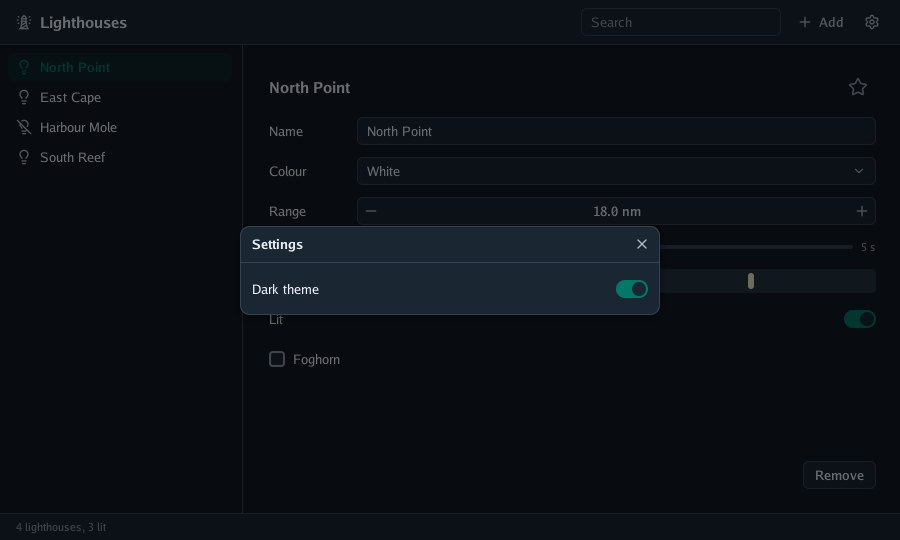
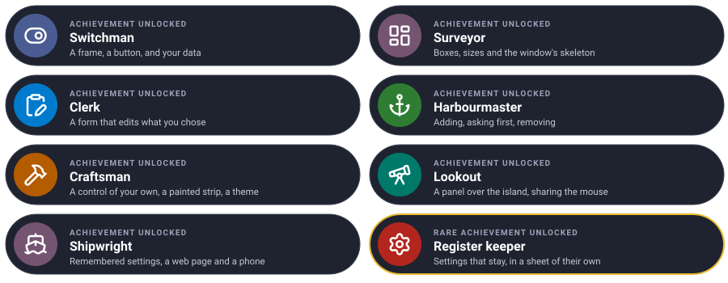

# Lesson 7: shipping it

The register works on your computer. In this last lesson it remembers what it was showing, behaves
well when it leaves the screen, and runs in a web page and on a phone, **from the same code**.

| Mission | Pieces | Time |
|---|---|---|
| The register in a browser and on a phone | preferences, `Hidden`, `GOOS=js`, go-ui-apk | 15 min |

#### The idea

One program, **three harbours**: the same code sails to a window, a web page and a phone; the window package is the pilot that knows each port. Before leaving one, write down where you were (the preferences), because the phone may close the app without asking.

## Remembering between runs

`window.KeepPreference(name, value)` keeps a short text under a name: in the user's configuration
folder on the desktop, in the page's local storage in a browser, in the application's files on
Android. It is written at once. `window.Preference(name)` reads it back.

```go
// keep writes down what should survive the program: the lighthouse chosen and the list's width.
func (program *register) keep() {
	window.KeepPreference("selected", strconv.Itoa(program.selected))
	window.KeepPreference("side width", strconv.Itoa(int(program.sideWidth)))
}

// restore takes up where the last run was left.
func (program *register) restore() {
	if text, found := window.Preference("selected"); found {
		if selected, err := strconv.Atoi(text); err == nil && selected < len(program.lighthouses) {
			program.selected = selected
		}
	}
	if text, found := window.Preference("side width"); found {
		if width, err := strconv.Atoi(text); err == nil {
			program.sideWidth = float32(width)
		}
	}
}
```

For a register of real size, keep the data itself in a file of your own (JSON, a database):
preferences are for a handful of settings.

## Leaving the screen

On a phone, another application can come up at any moment, and the system may then end yours
without a word. `Options.Hidden` is called when the program leaves the screen (on the desktop, when
the window closes; in a browser, when the page is hidden), and `Options.Shown` when it comes back:

```go
program.restore()
options.Hidden = program.keep
if err := window.Run(options, program.build); err != nil {
	log.Fatal(err)
}
```

## Waking from another goroutine

The window sleeps until something happens. If your data changes elsewhere (a download, a timer),
change it so the next frame sees it, then call `window.Wake()` so there is a next frame. Changing
data from two goroutines at once is still a race: hand the result over through a channel, or a
mutex the frame also takes.

## In a web page

Built for WebAssembly, `window.Run` opens the page's canvas instead of a window and draws through
WebGL2. Nothing in the program changes:

```bash
mkdir -p web
GOOS=js GOARCH=wasm go build -o web/register.wasm .
cp "$(go env GOROOT)/lib/wasm/wasm_exec.js" web/
cp "$(go list -m -f '{{.Dir}}' github.com/akrck02/go-ui)/web/index.html" web/   # Go UI's page
chmod u+w web/index.html                # files in the module cache are read-only
python3 -m http.server -d web 8080      # then open http://localhost:8080/?program=register
```

Go UI's `web/index.html` runs `name.wasm` from `?program=name`. The canvas follows the page's size;
the clipboard, the keyboard and preferences are the browser's ([in a web browser](../7-platforms/1-web.md)).

## On a phone

Built for Android, the same program is the application's activity, drawn through OpenGL ES. A
finger is the pointer, so every control works by touch, and the on-screen keyboard comes up for
text fields. To package it, use **go-ui-apk** from
[Go UI for Android](https://github.com/akrck02/go-ui-android), which needs the Android SDK, the NDK and
a JDK, and no Java code, Gradle or Android Studio:

```bash
go run github.com/akrck02/go-ui-android/cmd/go-ui-apk -name Register -id io.example.register .
adb install register.apk
```

A desktop layout is not a phone layout, though: the register's side list and form want a screen
each on a phone, with a navigation bar. Go UI for Android's `material` package draws pieces as
Android's own applications do (top bars, navigation bars, lists, sheets), and its tutorial starts
where this one ends. On a phone, also look at `context.Insets()` (the system's bars), `context.Size()`
(to choose a layout by the screen) and `context.Back()` (the back gesture) ([on Android](../7-platforms/2-android.md)).

#### Checkpoint

Close and open the register: the same lighthouse is chosen and the list as wide as you left it. Built for WebAssembly, it runs at `localhost:8080/?program=register`.


## What you learnt

- `KeepPreference` and `Preference` keep settings on every platform; `Options.Hidden` is the moment
  to keep them.
- `window.Wake()` asks for a frame from another goroutine.
- The same program runs in a page (`GOOS=js GOARCH=wasm`) and on Android (go-ui-apk).

## Final challenge · Register keeper

Give the register a **Settings** sheet, opened from a gear button in the toolbar, with a **Dark theme** toggle. The choice is kept between runs.

> **Hint:** a `bool` in the program, a `Sheet` shown while it is open, `ui.DarkTheme()` and `ui.LightTheme()`, and `KeepPreference` / `Preference` for the choice.

Try it on your own first, then compare with the solution.



<details>
<summary>🔓 Show the solution</summary>

```go
// in the register struct
settings, dark bool

// at the start of build, before the teal
if program.dark {
	context.Theme = ui.DarkTheme()
} else {
	context.Theme = ui.LightTheme()
}

// in the toolbar, after the menu
if context.FlatIconButton("settings", "") {
	program.settings = true
}

// at the end of build
if program.settings && context.Sheet("Settings", ui.SheetOptions{}, func() {
	if context.Toggle("Dark theme", &program.dark) {
		window.KeepPreference("dark", strconv.FormatBool(program.dark))
	}
}) {
	program.settings = false
}

// in main, before window.Run
if text, found := window.Preference("dark"); found {
	program.dark = text == "true"
}
```

</details>


## Well done



## Where next

- [The guide](../4-guides/1-getting-started.md): everything about layout, text fields, tables, drag and drop,
  screen readers, how a frame is drawn.
- [The reference](../6-reference/0-reference.md): every control and option.
- [Go UI for Android](https://github.com/akrck02/go-ui-android): Material Design 3 on phones.
- [The performance audit](../8-project/1-performance-audit.md): what an interface costs, measured.

---

[← Lesson 6](6-over-a-3d-scene.md) · [Tutorial](0-the-quest.md) · [Reference →](../6-reference/0-reference.md)
