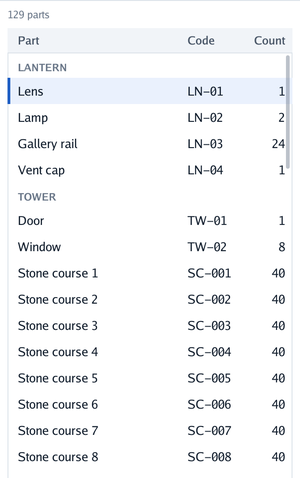
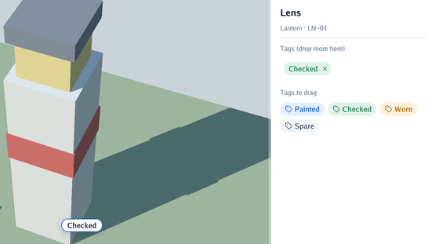

# 📋 Tables, dragging and resizing

`cmd/workbench` puts the pieces of an editor together around a 3D view: a list of a lighthouse's
parts on the left, an inspector with tags on the right, a menu to add a part, and a sheet that asks
before removing one. Both columns can be resized by their inner edge.

<p align="center">
<picture>
  <source media="(prefers-color-scheme: dark)" srcset="../images/workbench-dark.png">
  
</picture>
</p>

```bash
go run ./cmd/workbench                # -demo menu, -demo sheet or -demo drag open them for a capture
```

## Tables

<p align="center">
<picture>
  <source media="(prefers-color-scheme: dark)" srcset="../images/table-dark.png">
  
</picture>
</p>

```go
columns := []ui.Column{
	{Title: "Part", Width: ui.Share(1)},
	{Title: "Code", Width: ui.Fixed(64)},
	{Title: "Count", Width: ui.Fixed(56), Align: ui.End}, // numbers on the right
}
context.Table("parts", ui.Layout{Width: ui.Grow(), Height: ui.Grow()}, columns, func(table *ui.Table) {
	for index, part := range parts {
		if index == 0 || part.group != parts[index-1].group {
			table.Group(part.group) // a caption in small capitals, across the columns
		}
		if table.Row(part.key, index == selected, part.name, part.code, strconv.Itoa(part.count)) {
			selected = index
		}
	}
})
```

The header stays while the rows scroll. A selected row is tinted, with a strip of the primary
colour on its left; `Row` returns `true` when clicked. `Fixed` and `Share` widths make the header
and every row line up; text that does not fit its cell ends in "…". Rows and captions have fixed
heights, so the table counts the ones out of sight without building them: the loop still runs
over every row each step (a function call each, and the cells' strings are the program's), but
only the dozen or so in sight become boxes. A few thousand rows are fine. Give the table a height
that does not follow its content, or every row is built. Cells are text; Go Renderer has one
typeface, so there is no monospaced column yet.

## Drag and drop

<p align="center">
<picture>
  <source media="(prefers-color-scheme: dark)" srcset="../images/drag-dark.png">
  
</picture>
</p>

```go
context.DragSource("Painted", tagPainted, ui.Layout{}, func() { context.Chip("tag", "Painted", look) })

isTag := func(payload any) bool { _, ok := payload.(tagName); return ok }
if payload, dropped := context.DropTarget("part tags", layout, isTag, showTags); dropped {
	addTag(payload.(tagName))
}
context.End()

// the scene's side, after End
if drag, dragging := context.Dragging(); dragging && drag.OverScreen {
	previewAt(groundAt(drag.X, drag.Y)) // where it would land, with viewer.View.PointOnGround
}
if drop, dropped := context.DroppedOnScreen(); dropped {
	placeAt(groundAt(drop.X, drop.Y), drop.Payload)
}
```

| Call | What it does |
|---|---|
| `DragSource(name, payload, layout, content)` | A box that can be dragged, carrying a value of yours; returns `true` when clicked instead |
| `DropTarget(name, layout, accepts, content)` | A box that takes the payloads `accepts` says (nil takes any); returns the payload on the step it is let go there |
| `Dragging()` | The payload, the pointer and whether it is over the open screen, during a drag |
| `DroppedOnScreen()` | A payload let go over the open screen, with the pointer's place |

Any box can be a **drag source** carrying a value of yours (`any`). A press on it that moves four
pixels or more becomes a drag; less is a click, which `DragSource` returns, so a chip inside can
still be clicked. Buttons inside keep their clicks too, but a drag that starts on them takes the
mouse from them. While dragging, the source itself follows the pointer, as a card in the hand: what it drew
is drawn again under the pointer, over everything and with a shadow, held where it was taken, and
a faint copy stays in its place. The pointer
shows four arrows (Go Renderer has no closed-hand shape), and the interface holds the mouse and the
keyboard, so cameras stay still and Escape cancels the drag.

A **drop target** is a box that takes payloads: `accepts` says which (nil takes any). While one it
takes is over it, it is highlighted; on the step it is let go there, `DropTarget` returns it. With
targets inside targets, the innermost under the pointer takes the drop.

Let go over the **open screen** (no panel, no painted box, no target) and the payload is the
program's: `DroppedOnScreen` reports it with the pointer's place on the step of the release, from
`Begin` to the next `Begin`, so it can be asked after `End`, next to the scene's code. During the
drag, `Dragging` tells the payload, the pointer and whether it is over the open screen, to preview
the drop on the scene.

## Resizable boxes

```go
context.Resizable("parts", ui.RightSide, &sideWidth, 240, 520, ui.Layout{Direction: ui.Vertical, Height: ui.Grow()}, func() { … })
```

A resizable box has a handle on one side (`RightSide` for a column on the left of the window,
`LeftSide` for one on the right, `BottomSide` and `TopSide` for strips): a thin line, drawn like a
separator, that turns the primary colour and shows the resize pointer under the mouse. Dragging it
writes the new width or height into your variable, kept between the minimum and the maximum (0 =
no maximum); the program keeps the variable and can save it. The layout's size along the handle
comes from the variable; the rest of the layout applies to the content.
