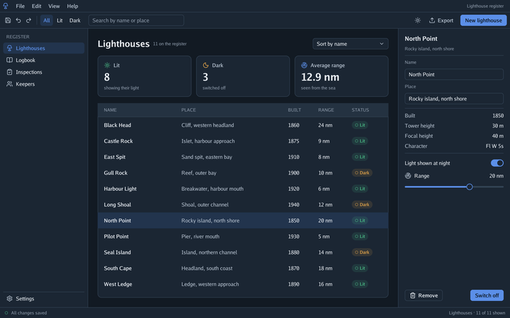

# 🎨 Themes

Every control reads its colours and sizes from `interfaceContext.Theme`: surfaces, inks, lines,
the primary colour, the scrim behind sheets, text sizes, control height, gaps, padding, corner radii
and the shadow. `LightTheme()` is the default; `DarkTheme()` has the same sizes with dark colours.
Change a token and every control follows.

<table>
<tr>
<th width="50%"><code>LightTheme()</code></th>
<th width="50%"><code>DarkTheme()</code></th>
</tr>
<tr>
<td></td>
<td></td>
</tr>
</table>

Every example takes `-dark` to start in the dark theme. `window.SystemPrefersDark()` tells whether
the phone or the browser is set to a dark theme, so a program can follow it (on the desktop it says no for now)
([Android](../7-platforms/2-android.md)).

On Android 12 and later, `window.SystemPalettes()` returns the five palettes the phone makes from
the wallpaper, to build a theme from them ([Android](../7-platforms/2-android.md)).
