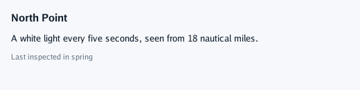
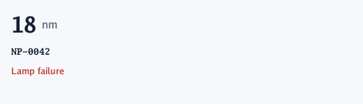
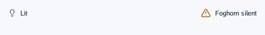

# Text, icons and pictures

## `Heading`, `Label`, `Caption`

Three levels of text for nearly everything: a bold title, body text, and a small quiet line for
hints, counts and dates.

```go
context.Heading("North Point")
context.Label("A white light every five seconds, seen from 18 nautical miles.")
context.Caption("Last inspected in spring")
```



- One line each: text does not wrap. A line too long for a box that clips (`Look{Clip: true}`, a
  table cell) ends in "…".
- Sizes come from the theme: `HeadingSize`, `TextSize`, `SmallTextSize`.
- A screen reader reads texts beside each other in one box together, as one sentence.

## `Text`

Any size, weight and colour, for the cases the three levels do not cover: a big figure with its
unit, a code in a monospaced face, a state in its colour.

```go
theme := context.Theme
context.Row(func() {
	context.Text("18", ui.TextStyle{Size: 32, Weight: draw2d.Bold})
	context.Text("nm", ui.TextStyle{Size: 16, Color: theme.InkSoft})
})
context.Text("NP-0042", ui.TextStyle{Weight: draw2d.Mono})                             // a code
context.Text("Lamp failure", ui.TextStyle{Weight: draw2d.Medium, Color: theme.Danger}) // a state
```



| `ui.TextStyle` field | Means |
|---|---|
| `Size` | Pixels; 0 = the theme's text size |
| `Weight` | `draw2d.Regular`, `Medium`, `Bold`, or `Mono` for codes and keys |
| `Color` | Zero = the theme's ink. Use the theme's tokens (`Danger`, `Warning`, `InkSoft`) so the dark theme follows |

## `Icon`, `IconSized`

A [Lucide](https://lucide.dev/icons) icon by name. `Icon` draws it at the theme's icon size in the
soft ink; `IconSized(name, size, colour)` chooses both.

```go
theme := context.Theme
context.Row(func() {
	context.Icon("lightbulb")
	context.Label("Lit")
	context.Spacer()
	context.IconSized("triangle-alert", 20, theme.Warning)
	context.Label("Foghorn silent")
})
```



An icon alone says nothing to a screen reader but its name ("triangle alert"): put words beside
it, or describe the control it belongs to (`Describe`).

## `Image`

A photo or any picture (`draw2d.Image`) filling a box, cropped evenly where their shapes differ,
with rounded corners. Decode it once and keep it: the picture is uploaded once.

```go
//go:embed north-point.jpg
var northPointFile []byte

photo, err := draw2d.DecodeImage(bytes.NewReader(northPointFile)) // once, at the start
…
context.Image(photo, ui.Layout{Width: ui.Fixed(160), Height: ui.Fixed(100)}, 8)
```

To show other pixels in it (a video's next frame), write them into `photo.Pixels` and call
`photo.Changed()`.

## `Tooltip`

Explains the control added just before it, in a small dark note, once the pointer rests on it for
half a second (the theme's `TooltipDelay`). For an icon button, it is the button's words.

```go
context.Row(func() {
	context.IconButton("rotate-ccw", "")
	context.Tooltip("Back to 18 nm and 5 s")
})
```

A finger has no hover: on a phone, tooltips never show, so nothing important should be only in one.

---

[← Components](0-components.md) · [Buttons →](2-buttons.md)
