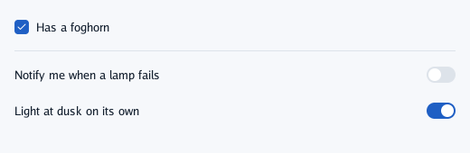
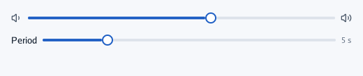
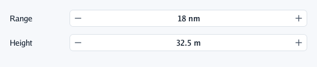
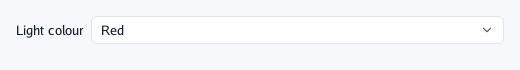
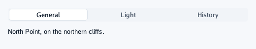
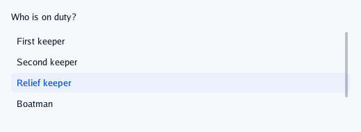

# Choices

Controls that edit a value of yours. Each takes a **pointer** to it, writes the new value as the
person acts, and returns `true` on the frame it changed: read your variable everywhere else, and
use the `true` only for what should happen once (a note, saving).

## `Checkbox` and `Toggle`

Both edit a `bool`. A **checkbox** is a fact about what is being edited, often one of several in a
form, applied with the form. A **toggle** (a switch on the right of its label) is a setting that
takes effect at once.

```go
context.Checkbox("Has a foghorn", &foghorn) // a fact about the thing being edited
context.Separator()
context.Toggle("Notify me when a lamp fails", &notify) // a setting that takes effect at once
context.Toggle("Light at dusk on its own", &autoLight)
```



Clicking the label flips it too. A screen reader says "ticked" or "on".

## `Slider` and `SliderStep`

A value between two ends, dragged. Click the track to jump, drag the knob, hold **Shift** to move
ten times slower. `SliderStep` keeps whole steps. A slider shows no number: put one beside it when
the exact value matters, or use a number field.

```go
context.Row(func() {
	context.Icon("volume-1")
	context.Slider("volume", &volume, 0, 1) // any value: a volume, an opacity
	context.Icon("volume-2")
})
context.Row(func() {
	context.Label("Period")
	context.SliderStep("period", &period, 1, 20, 1) // whole seconds only
	context.Caption(fmt.Sprintf("%.0f s", period))
})
```



A screen reader reads its range and moves it a step at a time.

## `NumberField`

A number with − and + on its sides, for exact values. Click − or +, **drag the number sideways**
(a step every 4 pixels), or click it and **type** (a point or a comma for decimals; Enter keeps
it, Escape does not). The format (`fmt` style) shows the unit.

```go
context.Row(func() {
	context.Box(ui.Layout{Width: ui.Fixed(90)}, func() { context.Label("Range") })
	context.NumberField("range", &rangeNM, 1, 30, 1, "%.0f nm")
})
context.Row(func() {
	context.Box(ui.Layout{Width: ui.Fixed(90)}, func() { context.Label("Height") })
	context.NumberField("height", &height, 0, 200, 0.5, "%.1f m")
})
```



## `Select`

One choice of a list, shown in a field; clicking opens the list over everything, under the field
or above it when there is no room. Choose with a click, or the arrows and Enter; Escape or a click
elsewhere closes it. While open it holds the keyboard.

```go
colours := []string{"White", "Red", "Green", "Amber"}
context.Row(func() {
	context.Label("Light colour")
	if context.Select("colour", &colour, colours) {
		context.Toast("Colour set to "+colours[colour], false)
	}
})
```



For two to four short options always in sight, use `Tabs` instead.

## `Tabs`

A segmented row, the chosen segment raised. It only chooses: show what belongs to the tab with an
`if` or a `switch`, like any other content.

```go
context.Tabs("view", &tab, "General", "Light", "History")
switch tab {
case 0:
	context.Label("North Point, on the northern cliffs.")
case 1:
	context.Label("White, every five seconds.")
case 2:
	context.Label("Built a long time ago.")
}
```



## `ListBox`

A scrolling list of selectable items, for a choice among more options than a select should hold
and that the person should see at once.

```go
keepers := []string{"First keeper", "Second keeper", "Relief keeper", "Boatman", "Cook", "Signal officer"}
context.Label("Who is on duty?")
context.ListBox("keepers", ui.Layout{Width: ui.Grow(), Height: ui.Fixed(130)}, keepers, &keeper)
```



---

[← Buttons](2-buttons.md) · [Text fields →](4-text-fields.md)
