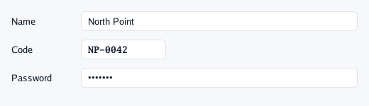
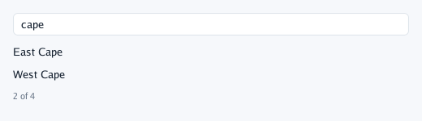
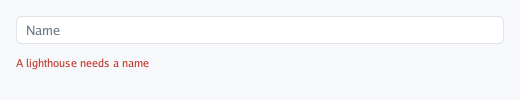

# Text fields

`TextField(name, &text)` and `TextFieldWith(name, &text, options)` edit your string in place, and
return `true` on the frames it changes. The name is the field's id, not shown.

## A form

A label column of its own width, then the fields. `MaxLength` caps what is typed, `Weight:
draw2d.Mono` writes codes in a monospaced face, `Width` fixes a short field, `Secret` hides a
password (a dot per character, nothing can be copied or cut).

```go
row := func(label string, field func()) {
	context.Row(func() {
		context.Box(ui.Layout{Width: ui.Fixed(90)}, func() { context.Label(label) })
		field()
	})
}
row("Name", func() { context.TextFieldWith("name", &name, ui.TextFieldOptions{MaxLength: 40}) })
row("Code", func() {
	context.TextFieldWith("code", &code, ui.TextFieldOptions{Weight: draw2d.Mono, Width: ui.Fixed(120)})
})
row("Password", func() { context.TextFieldWith("password", &password, ui.TextFieldOptions{Secret: true}) })
```



## `EntryField`

A line that is sent with Enter, such as a tag to add or a message to post. It returns true on the
step Enter is pressed; the program takes the text, clears it, and gives the field the keyboard back
so the next one can be typed straight away.

```go
if context.EntryField("tag", &typed, ui.TextFieldOptions{Placeholder: "Add a tag…"}) {
	tags = append(tags, typed)
	typed = ""
	context.FocusField("tag")
}
```

## A search

Nothing needs to "listen" to the field: the list below reads `search` in the same frame.

```go
context.TextFieldWith("search", &search, ui.TextFieldOptions{Placeholder: "Search lighthouses"})
found := 0
for _, name := range names {
	if strings.Contains(strings.ToLower(name), strings.ToLower(search)) {
		context.Label(name)
		found++
	}
}
context.Caption(fmt.Sprintf("%d of %d", found, len(names)))
```



`Placeholder` shows, quiet, while the field is empty. To open a search ready to type in (a
shortcut, a screen just shown), call `context.FocusField("search")`.

## Checking what was typed

Say what is wrong right under the field, in the theme's danger colour, while it is wrong.

```go
context.TextFieldWith("name", &name, ui.TextFieldOptions{Placeholder: "Name", MaxLength: 40})
if strings.TrimSpace(name) == "" {
	context.Text("A lighthouse needs a name", ui.TextStyle{Size: context.Theme.SmallTextSize, Color: context.Theme.Danger})
}
```



## Typing, everywhere

| To | Do |
|---|---|
| Place the caret, select | Click; Shift-click; drag; double-click a word, triple-click all |
| Move by words, to the ends | Alt (Mac) or Ctrl with the arrows; Home, End |
| Copy, cut, paste, select all | Cmd or Ctrl with C, X, V, A |
| Undo, redo | Cmd/Ctrl+Z, Shift+Cmd/Ctrl+Z or Cmd/Ctrl+Y |
| Finish | Enter or a click elsewhere; **Escape puts back** the text it had when it took the keyboard |
| Next field | Tab, Shift+Tab: round the fields of the panel or sheet |

Accents and «ñ» type as anywhere (characters come after the keyboard layout). Pasted line breaks
become spaces. On a phone the on-screen keyboard comes up, suggests words and underlines the one
it composes; a finger held on a word selects it, with handles and a bar to cut, copy and paste.

While a field has the keyboard, Go UI **claims** it, so a 3D view's shortcuts do not take the
letters. `FieldFocused(name)` tells whether a field has it; `Focus(path...)` gives it to a field
found by its scopes, with its text selected.

---

[← Choices](3-choices.md) · [Containers →](5-containers.md)
