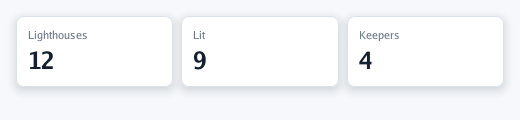
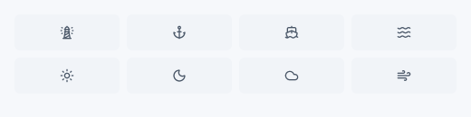
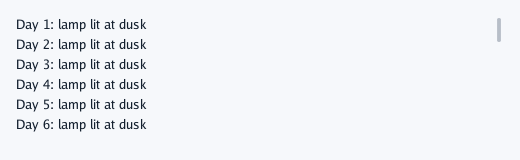
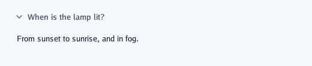
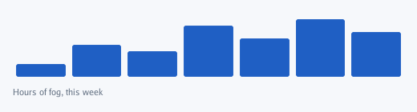

# Containers

Boxes arrange what is inside them. Their `ui.Layout` gives a direction, sizes (`Fit`, `Grow`,
`Share`, `Fixed`, `Percent`), padding, a gap and alignment; the [guide](../4-guides/2-layout.md)
explains how sizes are worked out.

## `Box` and `Frame`

`Box` only arranges. `Frame` also paints, with a `ui.Look`: fill, border, corner radius, a shadow
for things that float, and a clip. Cards side by side with `Share(1)` come out the same width.

```go
theme := context.Theme
card := ui.Look{Fill: theme.Surface, Border: theme.Line, BorderWidth: 1, Radius: 8, Shadow: true}
context.Row(func() {
	for _, figure := range [][2]string{{"Lighthouses", "12"}, {"Lit", "9"}, {"Keepers", "4"}} {
		context.Frame(ui.Layout{Direction: ui.Vertical, Width: ui.Share(1), Padding: ui.Pad(12), Gap: 4}, card, func() {
			context.Caption(figure[0])
			context.Text(figure[1], ui.TextStyle{Size: 24, Weight: draw2d.Bold})
		})
	}
})
```



## `Row`, `Column`, `Spacer`, `Separator`

`Row` is a full-width horizontal box with the theme's gap, its children centred vertically;
`Column` the same, vertical. `Spacer` takes the free space and pushes what follows to the far end
(a button on the right of a bar). `Separator` is a thin line across its row or column.

```go
context.Row(func() {
	context.Heading("North Point")
	context.Spacer()
	context.Button("Edit")
})
context.Separator()
```

## `Grid`

Rows of equal cells, left to right and then down: `Grid(columns, content)`, or any box with
`Layout.Columns`.

```go
context.Grid(4, func() {
	for _, icon := range []string{"lighthouse", "anchor", "ship", "waves", "sun", "moon", "cloud", "wind"} {
		context.Frame(ui.Layout{Width: ui.Grow(), Padding: ui.Pad(12), AlignX: ui.Center},
			ui.Look{Fill: context.Theme.Sunken, Radius: 6}, func() { context.Icon(icon) })
	}
})
```



## `ScrollArea`

Content taller than its box scrolls: the wheel or a trackpad over it, the thin bar on its right,
or a finger, which glides on when let go. Give it a height that does not follow its content
(`Fixed`, or `Grow` in a column), or it simply grows.

```go
context.ScrollArea("log", ui.Layout{Direction: ui.Vertical, Width: ui.Grow(), Height: ui.Fixed(120), Gap: 4}, func() {
	for day := 1; day <= 30; day++ {
		context.Label(fmt.Sprintf("Day %d: lamp lit at dusk", day))
	}
})
```



`ScrollOffset(name)` says how far it is scrolled (a bar that shrinks over it); `ScrollPull(name)`
measures a pull past its top (a list that refreshes).

## `Fold`

A box that opens to its content's height and closes to nothing, with motion: the answer under a
question, more under a row. While closed, its content is not built at all.

```go
if context.FlatIconButton("chevron-down", "When is the lamp lit?") {
	open = !open
}
context.Fold("answer", open, 200*time.Millisecond, ui.Layout{Width: ui.Grow(), Padding: ui.PadXY(12, 4)}, func() {
	context.Label("From sunset to sunrise, and in fog.")
})
```



## `Paint`

A box laid out like any other, then handed to your function with its final rectangle and a
`draw2d.List`: for shapes no control draws (a chart, a gauge, a timeline).

```go
readings := []float32{0.2, 0.5, 0.4, 0.8, 0.6, 0.9, 0.7}
primary := context.Theme.Primary
context.Paint(ui.Layout{Width: ui.Grow(), Height: ui.Fixed(80)}, func(area draw2d.Rectangle, drawing *draw2d.List) {
	barWidth := area.Width / float32(len(readings))
	for index, reading := range readings {
		height := area.Height * reading
		bar := draw2d.Rectangle{X: area.X + float32(index)*barWidth + 4, Y: area.Bottom() - height, Width: barWidth - 8, Height: height}
		drawing.Rectangle(bar, 3, primary, draw2d.Transparent, 0)
	}
})
context.Caption("Hours of fog, this week")
```



## `SwipeBox`

A box a finger drags along one axis: pages, cards in a row, a row swiped away. Your content gets a
`ui.Swipe` (the offset, the speed, whether it is held or just let go) and places itself by it.

```go
context.SwipeBox("pages", ui.Layout{Width: ui.Grow(), Height: ui.Fixed(200)}, ui.Horizontal, func(swipe ui.Swipe) {
	if swipe.Released && swipe.Offset < -swipe.Area.Width/3 {
		page++ // let go past a third of the way: the next page
	}
	…
})
```

It takes a finger only along its own axis, so a list inside pages still scrolls up and down.

---

[← Text fields](4-text-fields.md) · [Lists and tables →](6-lists-and-tables.md)
