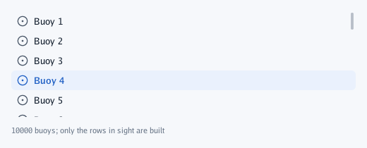
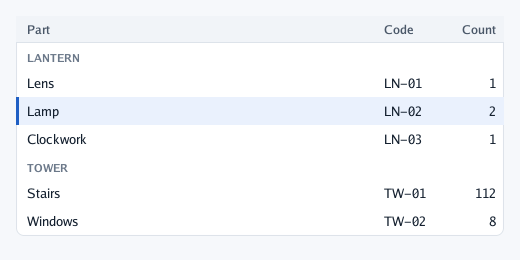

# Lists and tables

## `List`

A scroll area of rows of **the same height** that builds only the rows in sight: ten thousand rows
cost what twenty do. The row function gets the index; ids inside it are scoped by it, so no
`Push` is needed.

```go
const count = 10000
context.List("buoys", ui.Layout{Width: ui.Grow(), Height: ui.Fixed(150)}, count, 28, func(index int) {
	if context.Selectable("circle-dot", fmt.Sprintf("Buoy %d", index+1), index == selected) {
		selected = index
	}
})
context.Caption(fmt.Sprintf("%d buoys; only the rows in sight are built", count))
```



For a few dozen rows of different heights, a `ScrollArea` with a `for` is simpler.

## `Table`

A header that stays while the rows scroll, columns that line up, group captions, a chosen row with
a strip of the primary colour. `Row(id, selected, cells...)` returns `true` when clicked; cells are
text, and text that does not fit ends in "…".

```go
type part struct {
	group, name, code string
	count             int
}
parts := []part{
	{"Lantern", "Lens", "LN-01", 1}, {"Lantern", "Lamp", "LN-02", 2}, {"Lantern", "Clockwork", "LN-03", 1},
	{"Tower", "Stairs", "TW-01", 112}, {"Tower", "Windows", "TW-02", 8},
}
columns := []ui.Column{
	{Title: "Part", Width: ui.Share(1)},
	{Title: "Code", Width: ui.Fixed(72)},
	{Title: "Count", Width: ui.Fixed(56), Align: ui.End}, // numbers on the right
}
context.Table("parts", ui.Layout{Width: ui.Grow(), Height: ui.Fixed(220)}, columns, func(table *ui.Table) {
	for index, item := range parts {
		if index == 0 || item.group != parts[index-1].group {
			table.Group(item.group)
		}
		if table.Row(item.code, index == selected, item.name, item.code, strconv.Itoa(item.count)) {
			selected = index
		}
	}
})
```



| `ui.Column` field | Means |
|---|---|
| `Title` | The header's words |
| `Width` | `Fixed` for narrow columns, `Share` for the rest: header and rows come out the same |
| `Align` | `ui.Start` for words, `ui.End` for numbers |
| `Weight` | `draw2d.Mono` for a column of codes |

`table.RowWith(id, selected, ui.RowLook{Icon, IconInk, Tile, Indent, Secondary}, cells...)` starts
the first cell with an icon on a tinted tile, a second quieter line, or an indent for a row that
belongs to the one above. Rows and captions out of sight are only counted, so a few thousand rows
are fine; give the table a height that does not follow its content.

---

[← Containers](5-containers.md) · [Layers →](7-layers.md)
