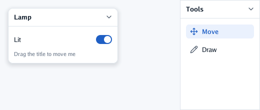
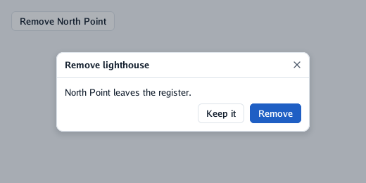
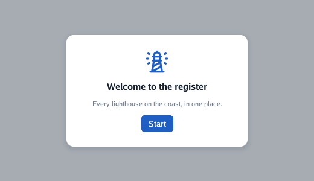
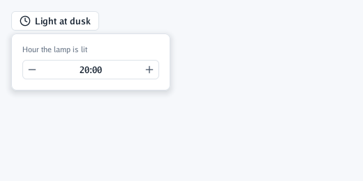

# Layers

What floats over the rest. What is described later in a frame is drawn on top; popups (menus,
selects, tooltips) go over everything.

## `Panel` and `PanelWith`

A floating card with a title bar: drag the bar to move it, the chevron folds it, pressing it brings
it to the front. Its title opens a scope, so controls in two panels never mix. `PanelOptions` places
it (`X`, `Y`), sizes it, `Locked` stops it moving, and `Dock` fills a side of the window.

```go
context.PanelWith("Lamp", ui.PanelOptions{X: 16, Y: 16, Width: ui.Fixed(220)}, func() {
	context.Toggle("Lit", &on)
	context.Caption("Drag the title to move me")
})
context.PanelWith("Tools", ui.PanelOptions{Dock: ui.DockRight, Width: ui.Fixed(160)}, func() {
	context.Selectable("move", "Move", true)
	context.Selectable("pencil", "Draw", false)
})
```



Panels are for tools over a scene or a canvas. An application's fixed parts (bars, side columns)
are better as boxes on the screen ([containers](5-containers.md)).

## `Sheet`

A modal card in the middle of the window, shown with an `if` for as long as your program wants.
Everything behind is dimmed and does not react; Tab goes round the sheet's own fields. It returns
`true` on the frame the person asks to close it: Escape, the × or a click on the backdrop.

```go
if context.Button("Remove North Point") {
	confirming = true
}
if confirming && context.Sheet("Remove lighthouse", ui.SheetOptions{Width: ui.Fixed(360)}, func() {
	context.Label("North Point leaves the register.")
	context.Row(func() {
		context.Spacer()
		if context.Button("Keep it") {
			confirming = false
		}
		if context.PrimaryButton("Remove") {
			confirming = false
		}
	})
}) {
	confirming = false // Escape, the × or a click on the dimmed backdrop
}
```



## `Modal`

Like a sheet, but drawn entirely by you: a welcome card, a dialog of your own, a drawer. Place it
with `LayerOptions` (`AlignX`, `AlignY`, `Padding`, `Width`, `Height`); `Leave` lets it go with
motion.

```go
if open && context.Modal("welcome", ui.LayerOptions{AlignX: ui.Center, AlignY: ui.Center}, func() {
	context.Frame(ui.Layout{Direction: ui.Vertical, Padding: ui.Pad(24), Gap: 12, Width: ui.Fixed(300), AlignX: ui.Center},
		ui.Look{Fill: context.Theme.Surface, Radius: 12, Shadow: true}, func() {
			context.IconSized("lighthouse", 40, context.Theme.Primary)
			context.Heading("Welcome to the register")
			context.Caption("Every lighthouse on the coast, in one place.")
			if context.PrimaryButton("Start") {
				open = false
			}
		})
}) {
	open = false
}
```



`Overlay(name, options, content)` is the same without dimming or blocking: a note at the bottom, a
floating button.

## `MenuButton` and `MenuItem`

A flat button that opens a menu under it. The menu's content is described only while it is open;
`MenuItem(icon, label, hint)` returns `true` when chosen, and choosing closes it. Arrows and Enter
work. The hint (a shortcut's keys) is only shown: handle the shortcut yourself.

```go
context.Row(func() {
	context.MenuButton("plus", "Add", func() {
		if context.MenuItem("lighthouse", "Lighthouse", "Ctrl+N") {
			// add one
		}
		if context.MenuItem("anchor", "Harbour", "") {
			// add one
		}
		context.Separator()
		if context.MenuItem("copy", "Copy of the selected one", "Ctrl+D") {
			// copy
		}
	})
})
```

## `Popover`

A box of your own floating under the control added just before it, at least as wide: a small form
about one thing, a dropdown of your own. A click outside, Escape or the back gesture closes it
(`open` becomes `false`).

```go
context.Row(func() {
	if context.IconButton("clock", "Light at dusk") {
		open = !open
	}
	context.Popover("hour", &open, ui.Look{Fill: context.Theme.Surface, Border: context.Theme.Line, BorderWidth: 1, Radius: 8, Shadow: true}, func() {
		context.Box(ui.Layout{Direction: ui.Vertical, Padding: ui.Pad(12), Gap: 8, Width: ui.Fixed(220)}, func() {
			context.Caption("Hour the lamp is lit")
			context.NumberField("hour", &hour, 0, 23, 1, "%.0f:00")
		})
	})
})
```



## `Toast`

A short note at the bottom for a few seconds. Unlike everything else it is **fired once**, when
something happens, not described at every frame; `true` as the second argument makes it a warning.

```go
if context.Button("Save") || first {
	context.Toast("North Point was saved", false) // fired once; it fades on its own
}
if context.Button("Check the lamp") {
	context.Toast("The lamp did not answer", true) // a warning
}
```

---

[← Lists and tables](6-lists-and-tables.md) · [Dragging and resizing →](8-dragging-and-resizing.md)
