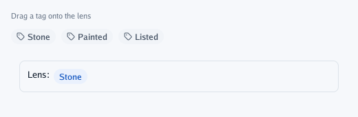
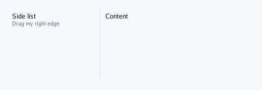

# Dragging and resizing

## `DragSource` and `DropTarget`

Drag a value of yours (`any`) from one box to another. A press that moves four pixels becomes a
drag; less is a click, which `DragSource` returns, so a chip inside can still be clicked. While
dragging, the source's name follows the pointer, the interface holds the mouse and the keyboard,
and Escape cancels.

A target says which payloads it takes (`accepts`; nil takes any), is highlighted while one is
over it, and returns it on the frame it is let go there. With targets inside targets, the innermost
takes it.

```go
theme := context.Theme
context.Caption("Drag a tag onto the lens")
context.Row(func() {
	for _, tag := range []tagName{"Stone", "Painted", "Listed"} {
		context.DragSource(string(tag), tag, ui.Layout{}, func() {
			context.Chip("tag", string(tag), ui.ChipLook{})
		})
	}
})
isTag := func(payload any) bool { _, ok := payload.(tagName); return ok }
target := ui.Layout{Width: ui.Grow(), Padding: ui.Pad(12), Gap: 6}
payload, dropped := context.DropTarget("lens", target, isTag, func() {
	context.Frame(ui.Layout{Width: ui.Grow(), Padding: ui.Pad(12), Gap: 6}, ui.Look{Border: theme.Line, BorderWidth: 1, Radius: 8}, func() {
		context.Label("Lens:")
		for _, tag := range onPart {
			context.Chip("", string(tag), ui.ChipLook{Fill: theme.PrimaryTint, Ink: theme.Primary})
		}
	})
})
if dropped {
	onPart = append(onPart, payload.(tagName))
}
```



### Onto the scene

Let go over the open screen (no panel, painted box or target) and the payload is the program's:
`DroppedOnScreen()` gives it with the pointer's place, to put it in a 3D scene
(`viewer.View.PointOnGround`). `Dragging()` tells about a drag in progress, to preview where it
would land.

```go
context.End()
if drop, dropped := context.DroppedOnScreen(); dropped {
	placeAt(groundAt(drop.X, drop.Y), drop.Payload)
}
```

## `Resizable`

A box with a handle on one side: `RightSide` for a column on the left of the window, `LeftSide`
for one on the right, `BottomSide` and `TopSide` for strips. Dragging the handle writes the new
size into your variable, between a minimum and a maximum (0 = none); keep the variable and save it
if you like.

```go
context.Box(ui.Layout{Width: ui.Grow(), Height: ui.Fixed(140)}, func() {
	column := ui.Layout{Direction: ui.Vertical, Height: ui.Grow(), Padding: ui.Pad(8)}
	context.Resizable("side", ui.RightSide, &width, 120, 320, column, func() {
		context.Label("Side list")
		context.Caption("Drag my right edge")
	})
	context.Box(ui.Layout{Width: ui.Grow(), Height: ui.Grow(), Padding: ui.Pad(8)}, func() { context.Label("Content") })
})
```



---

[← Layers](7-layers.md) · [Components](0-components.md)
