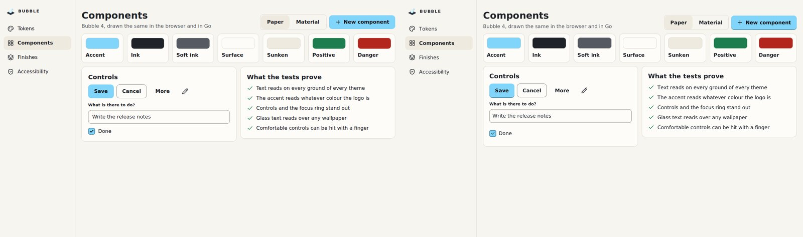
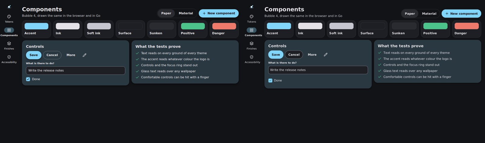
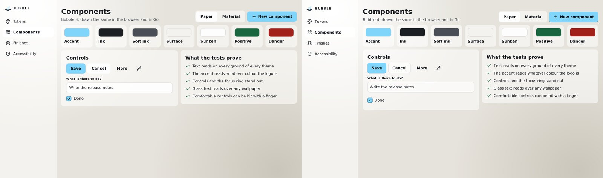
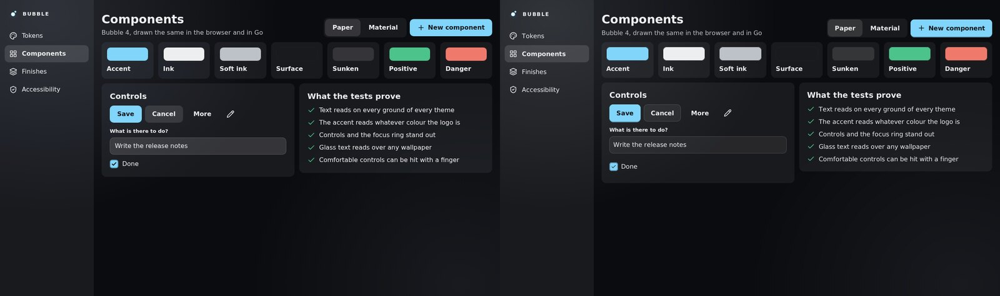

# In Bubble 4

[Bubble](https://github.com/akrck02/bubble) is the design system of akrck02's projects: one set of
tokens, made in Go with its contrast tested, drawn in CSS for the web. Package `go-ui/bubble`
turns a Bubble theme into go-ui's, so **every go-ui control follows it**, and the same screen looks
the same in a browser and in a go-ui window.

> **Status:** in development, like Bubble 4 itself (its `feature/v4` branch). go-ui builds against
> a copy of Bubble cloned next to it, as it does with go-renderer.

## The shortest way

```go
import (
	design "github.com/akrck02/bubble"
	"github.com/akrck02/go-ui/bubble"
)

accent, _ := design.ParseColor("#81D4FA") // the main colour of your logo
theme, err := design.NewTheme(design.Options{
	Style: design.StylePaper, Mode: design.ModeLight,
	Density: design.DensityComfortable, Accent: accent,
})
if err != nil {
	return err
}
context.Theme = bubble.Theme(theme) // before the first control of the frame
```

That is all: buttons, lists, fields and check boxes now wear Bubble. Bubble moves the accent until
every pairing reads, so you give it your logo's colour as it is.

## Side by side

`cmd/bubble` is one screen written twice: once with go-ui (`main.go`), once in HTML with Bubble's
CSS (`web.html`). On the left of each pair the browser, on the right go-ui:










Between 4 and 6 % of the pixels differ, mostly along the edges of letters, where each engine
smooths text its own way. `cmd/bubble/compare.sh` draws the pairs again and counts them; it needs
Bubble cloned next to go-ui, Chrome or Chromium, ImageMagick and a display (or `xvfb-run`).

Three differences are on purpose, or still to do:

- **A check box's row is 44 pixels tall** in go-ui, a finger's size, as Bubble asks of touch
  targets; the web page lets the box alone be the target.
- **A secondary button** is filled with the surface in go-ui and clear in the browser: on
  Material's tinted cards it shows.
- **A text field** keeps its text a little closer to the edge in go-ui.

## What the theme carries

Bubble's colours land on go-ui's tokens of the same role: `Surface`, `Sunken`, `Ink`, `InkSoft`,
`Line`, `ControlLine`, `FocusRing`… and the accent on `Primary`. Sizes come from Bubble's
density. The rest is what makes Bubble Bubble, and go-ui has a token for each:

| Token | What Bubble asks | go-ui's own look (when zero) |
|---|---|---|
| `ButtonRadius`, `ButtonPadding`, `ButtonGap`, `ButtonWeight` | Medium corners on paper, pills on material; more room, a bolder label | The controls' corners, 12 pixels a side |
| `PrimaryEdge`, `EdgeWidth` | The main button stands on a darker edge, like a block | No edge |
| `FlatHeight`, `FlatPadding`, `FlatInk` | Flat buttons as tall as the others, in ink | A little shorter, in soft ink, for toolbars |
| `Chosen`, `ChosenInk`, `ChosenWeight` | What is chosen is brighter and heavier, **never coloured** | The primary colour's tint |
| `ItemPadding`, `ItemGap`, `ItemIconInk` | The index's room and ink | Tighter, with soft icons |
| `LineHeight`, `HeadingLineHeight` | A line 1.5 times its size, a heading 1.2 | As tall as the letters |
| `CheckSize`, `CheckRadius`, `CheckBorder`, `CheckMark`, `CheckLine`, `CheckedBorder` | A larger box, its edge with a control's contrast, the accent's edge when ticked | go-ui's small box |

A theme that leaves these at zero, or invisible, keeps go-ui's look; a theme that only changes
`Primary` still marks the chosen item with its own tint.

## Glass

Glass is a finish of Bubble's paper: crystal panes, told apart by how bright they are, over a ground
lit by two soft lights. Ask for it, and paint its ground under the interface:

```go
theme, _ := design.NewTheme(design.Options{Style: design.StylePaper, Mode: design.ModeDark,
	Density: design.DensityComfortable, Accent: accent, Glass: true})
ground := draw2d.NewImage(bubble.Ground(theme, width, height)) // once, the window's size

window.Run(options, func(context *ui.Context) {
	context.Theme = bubble.Theme(theme)
	context.Image(ground, ui.Layout{Width: ui.Grow(), Height: ui.Grow()}, 0)
	context.Overlay("screen", ui.LayerOptions{Width: ui.Fixed(width), Height: ui.Fixed(height)}, func() {
		// the interface, over the ground
	})
})
```

`bubble.Theme` makes surfaces and wells the translucent panes, as Bubble's CSS does. The browser
blurs what is behind a pane; go-ui does not yet, but glass's own ground is smooth, so blurring it
would change nothing. Over a photograph, or over other text, it would: that is still to come in
go-renderer.

---

[← Components](0-components.md)
