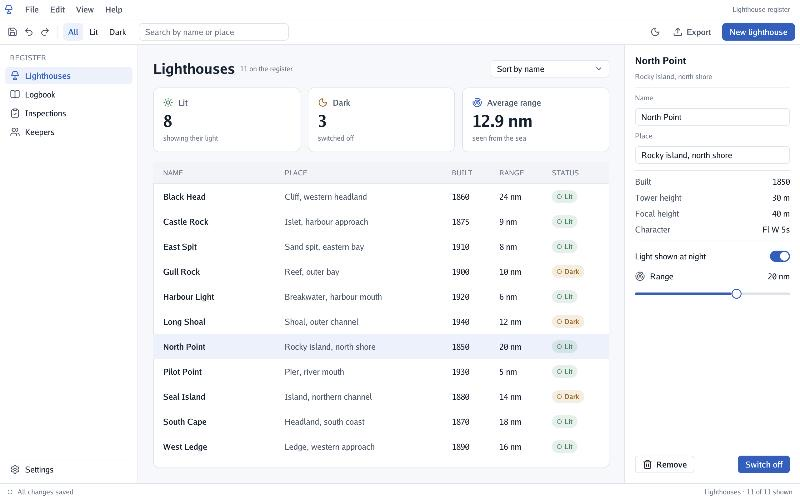
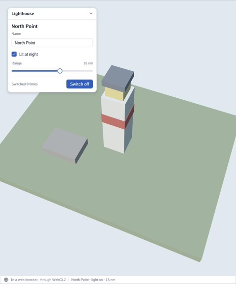

# 🌐 In a web browser

**Status:** a first step (October 2026). Go UI applications run in a browser, built for
WebAssembly and drawn through WebGL2, with the same code as on the desktop. The desktop is
unchanged.

<p align="center">
  
</p>

The register above is `cmd/app`, **not changed by a line**: `window.Run` opens a canvas instead
of a window when the program is built for the browser.

```bash
GOOS=js GOARCH=wasm go build -o web/app.wasm ./cmd/app
cp "$(go env GOROOT)/lib/wasm/wasm_exec.js" web/
python3 -m http.server -d web 8080        # then open http://localhost:8080/?program=app
```

`web/index.html` is one page for every program: `?program=name` runs `name.wasm` from the same
folder.

## Over a 3D scene

<p align="center">
  
</p>

`cmd/web` is the same kind of program as `cmd/example`: the lighthouse island with a panel to look
after its light and a status bar. On the desktop, `viewer.Run` draws the scene; it needs GLFW, so
in a browser the program puts the pieces together itself, in about thirty lines:

```go
canvas, _ := browser.OpenCanvas("view")
functions, _ := canvas.WebGL(true)              // antialiased, for the 3D edges
renderer, _ := gles.NewSceneRenderer(functions, overlay.Fonts{})
world.Overlay.Drawing = interfaceContext.Drawing()

app.Update = func(app *rendererwindow.Application, step float64) error {
	interfaceContext.Begin(app.Input)
	lighthousePanel(interfaceContext, light)
	interfaceContext.End()
	unclaimed := app.Input.Unclaimed()          // the camera gets what the panel did not take
	orbit.Update(&unclaimed, step, &app.Camera)
	return nil
}
browser.Run(canvas, app, func() error {
	renderer.Draw(world, app.Camera, width, height)
	return nil
})
```

```bash
GOOS=js GOARCH=wasm go build -o web/web.wasm ./cmd/web     # then ?program=web
```

The scene is drawn by Go Renderer's simple OpenGL ES renderer: light, fog and water, but no
shadows or sky yet (see Go Renderer's `docs/web.md`).

## How the window works in a page

| On the desktop | In a browser |
|---|---|
| A GLFW window, sized by `Options.Width` and `Height` | The page's canvas (`Options.Canvas`, its id; the first canvas when empty), sized by the page |
| Metal or OpenGL 4.1 | WebGL2, through Go Renderer's `gles.FlatRenderer`: the same atlas and quads, one draw call |
| `Options.Title` is the window's title | It becomes the page's title |
| Sleeps in `glfw.WaitEvents` between frames | Asks for an animation frame only when something happens |
| `window.Wake()` posts an empty event | `window.Wake()` asks for an animation frame |
| Closing the window ends `Run` | `window.Stop()` ends `Run`, for a page that takes the canvas away (below) |

Everything else is shared: one interface step per frame, no frame when the draw list's
fingerprint says it would look the same, `Options.Continuous` to draw every frame. Measured in the
register: **no frames at all in two seconds of idling**.

**One screen of a larger web application.** Give the program the page's canvas by id
(`Options.Canvas`) and leave `Options.Title` empty, so the page keeps its own title. When the page
leaves that screen, it asks the program to stop (a function the program hands the page through
`syscall/js` calls `window.Stop()`): `Run` returns, the canvas's listeners come off the page and the
program exits. Opening the screen again starts a new one.

The window's code is split by build tags: `window.go` (options, the interface application, frames
that look the same) for everyone, `desktop.go`, `thread.go` and the Metal files for desktops, and
`web.go` for WebAssembly.

## Text, keys and the clipboard

Keys arrive by their place on the keyboard, as on the desktop, and typed characters as the
browser gives them, so accents and other layouts work. Copy (Cmd or Ctrl and C) offers the text to
the system clipboard too; paste takes what the browser's paste event brings.

## What was checked, and what was not

Checked in Chromium on macOS: the register (filters, selecting rows, the inspector), the scene
example (buttons, a checkbox, a slider, typing and deleting in a text field, turning the camera
around the panel), sharp text on a high-density screen, and no frames while idle.

Not yet: other browsers, phones and tablets (touch arrives as a pointer, but Go UI has no touch
theme yet), the on-screen keyboard, and very large tables (each frame copies the draw list into
JavaScript once, which should be fine).

## Size

A program is one `.wasm` file of about 5.8 MB, about 1.9 MB compressed (web servers usually
compress on the fly). The fonts and icons are inside; the page loads nothing else.
