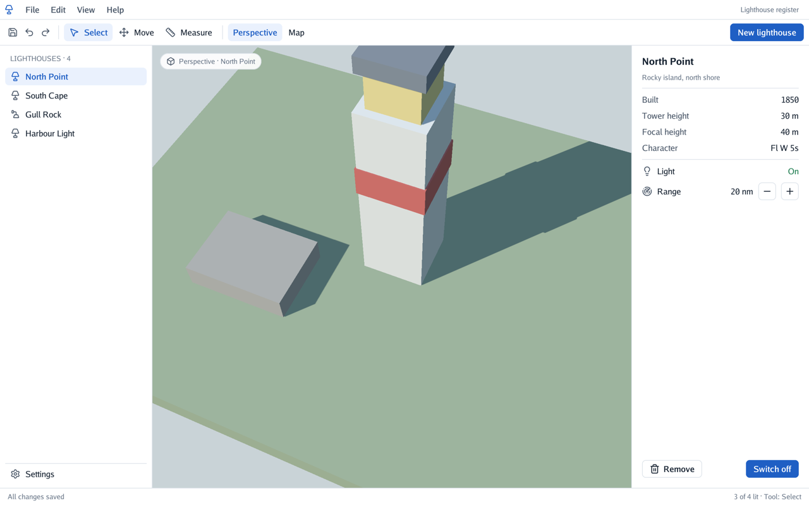
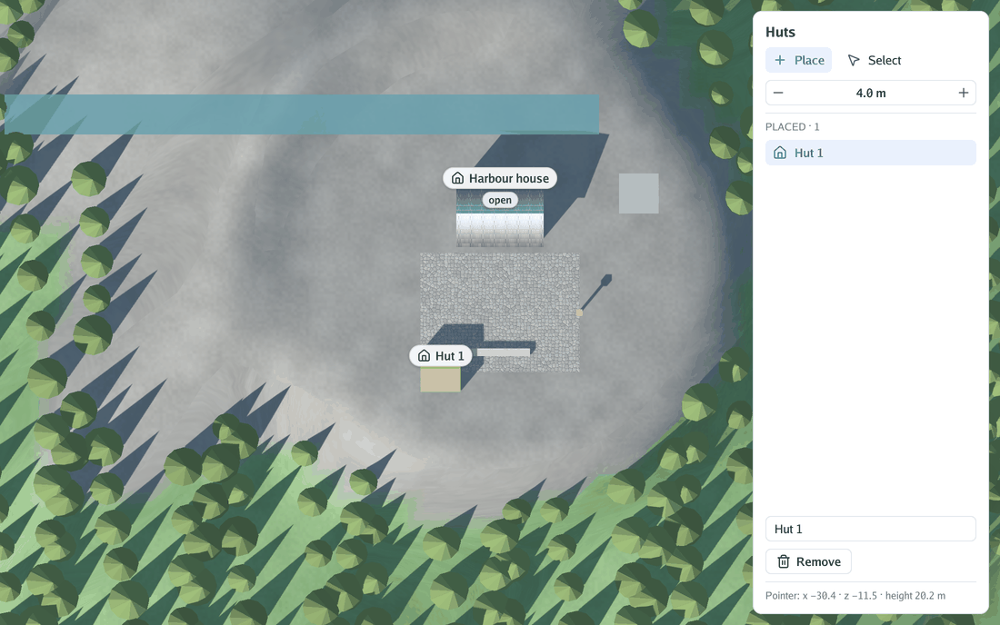
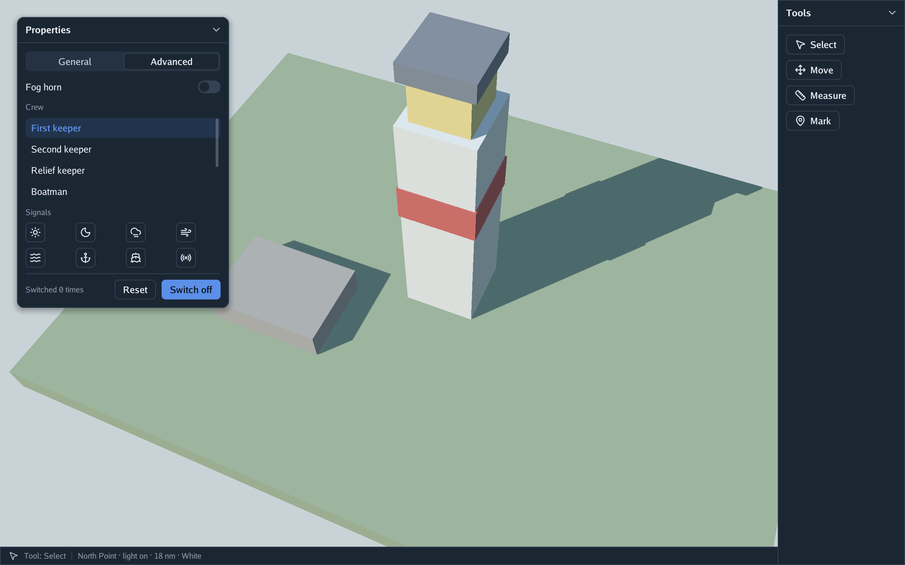
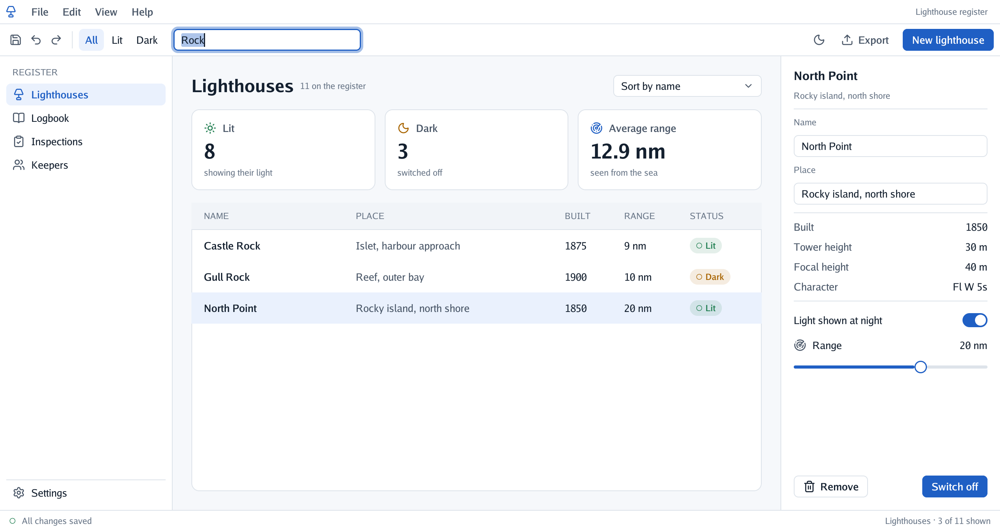
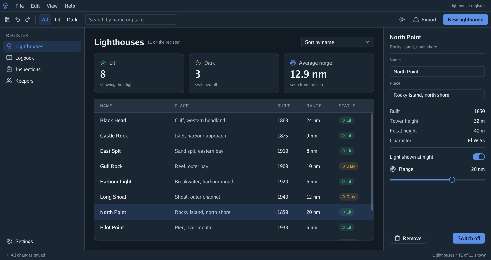

# go-ui documentation

go-ui draws interfaces over a go-renderer view. This page explains how a frame works, how boxes
are sized and placed, and what each control does.

| Section | What it covers |
|---|---|
| [A frame](#a-frame) | Immediate mode: describing the interface every step |
| [Boxes and layout](#boxes-and-layout) | How sizes and positions are worked out, and how to ask for a layout |
| [Controls](#controls) | Labels, buttons, panels, rows and columns |
| [Text fields](#text-fields) | Typing, selecting, the clipboard, undo, and moving between fields with Tab |
| [Mouse and keyboard](#mouse-and-keyboard) | Which control gets the pointer, and how the camera is kept out of the way |
| [Themes](#themes) | The tokens every control reads |
| [Applications without a scene](#applications-without-a-scene) | A plain window for interface-only programs |
| [How it is drawn](#how-it-is-drawn) | From boxes to go-renderer's draw list |
| [Performance and battery audit](performance-audit.md) | What an idle and a busy interface cost, measured, and what to improve in order |
| [Plan: Android](android.md) | What it would take to run go-ui applications on Android (not started) |

## A frame

In **immediate mode** there are no button objects to create, keep and update. Each update step,
the program calls the controls again, with its own variables:

```go
interfaceContext.Begin(state) // the step's mouse and keyboard
interfaceContext.Panel("Lighthouse", func() {
	interfaceContext.Heading(light.Name)
	if interfaceContext.PrimaryButton("Switch on") { // true on the step it is clicked
		light.On = true
	}
})
interfaceContext.End() // lay out, paint, claim the mouse
```

Showing or hiding something is an `if`; a list is a `for`. The interface holds none of your data,
so it can never show a stale value. What it does remember between frames is small and keyed by
each control's **id**: which control is being pressed, where a panel was dragged, whether it is
folded.

An id is a hash of the control's label and of the **scopes** around it. Panels open a scope with
their title, so two "Apply" buttons in different panels do not mix. Inside a loop, open a scope per
item with `Push(name)` and `Pop()`. Anything after `##` in a label is part of the id but not shown:
`"Switch off##switch"` and `"Switch on##switch"` are the same button with different words.

Call `Begin` and `End` in every update step (the function given to `viewer.Run`), and set
`world.Overlay.Drawing = interfaceContext.Drawing()` once, so go-renderer paints the result.

## Boxes and layout

Every control is a **box**, and boxes nest. Layout happens in `End`, once the whole tree is
known, so a box can grow into space that depends on boxes declared after it. A box's `Layout`
says:

| Field | Meaning |
|---|---|
| `Direction` | `Horizontal` (children left to right, the default) or `Vertical` (top to bottom) |
| `Width`, `Height` | `Fit()` (as big as the content, the default), `Grow()` / `GrowBy(weight)` (the content plus a share of the free space), `Share(weight)` (a share of the free space, starting from nothing: equal shares come out equal, so table columns line up), `Fixed(pixels)`, `Percent(share)`; `.Between(min, max)` bounds any of them |
| `Padding` | Space inside the edges: `Pad(all)`, `PadXY(horizontal, vertical)` or each side |
| `Gap` | Space between children |
| `AlignX`, `AlignY` | `Start`, `Center` or `End`: where children sit when there is room to spare |
| `Columns` | Above 0, a grid: children fill rows of this many equal cells, with `Gap` both ways |


The work is done one axis at a time:

1. **Fit**, from the leaves up: a text is as wide as it measures, an icon as its size; a box adds
   up its children along its direction (plus gaps) or takes the biggest across it, plus padding.
2. **Grow**, from the root down: percentages take their share of the parent; along the
   direction, growing children split the space left in proportion to their weights; across it,
   they take the parent's size. When the content does not fit (a narrow window), the growing
   children **shrink** instead, each giving up part of what it has above its minimum, so fixed
   and fitted boxes around them (a side column, an inspector, a button) keep their size.
3. **Place**, from the root down, with padding, gaps and alignment.

Text does not wrap yet, so heights never depend on widths. Content that still does not fit
overflows at the end and is cut by the panel. A line of text in a box whose look clips
(`Look{Clip: true}`, like a table cell) ends in "…" where it would pass the box's edge.

```go
interfaceContext.Box(ui.Layout{Direction: ui.Vertical, Width: ui.Grow(), Gap: 8}, func() { … })
interfaceContext.Frame(layout, ui.Look{Fill: theme.Surface, Border: theme.Line, BorderWidth: 1, Radius: 6}, func() { … })
```

`Box` only arranges; `Frame` also paints a fill, a border, rounded corners, a shadow or a clip
(`Look`). Because layouts and looks are plain structs, they can come from a file one day, like a
theme.

## Controls

| Control | What it does |
|---|---|
| `Panel(title, content)` | A floating card with a title bar: drag the bar to move it, the chevron folds it. Pressing a panel brings it to the front. |
| `PanelWith(title, PanelOptions{…}, content)` | The same, placed (`X`, `Y`), sized (`Width`, `Height`), `Locked`, or docked to an edge (`DockLeft`, `DockRight`, `DockTop`, `DockBottom`) |
| `Row(content)`, `Column(content)` | Shortcuts for full-width boxes with the theme's gap; a row centres its children vertically |
| `Spacer()` | Takes the free space of its row or column, pushing what follows to the end |
| `Separator()` | A thin line across its row or column |
| `Label(text)`, `Heading(text)`, `Caption(text)`, `Text(text, style)` | Lines of text: body, bold title, small hint, or any size, weight and colour |
| `Icon(name)`, `IconSized(name, size, colour)` | A [Lucide](https://lucide.dev/icons) icon |
| `Button(label)`, `PrimaryButton(label)`, `IconButton(icon, label)` | Return `true` on the step they are clicked; an icon button with an empty label is square |
| `FlatButton(label)`, `FlatIconButton(icon, label)` | Buttons with no fill or border until hovered: menu bars and toolbars |
| `Selectable(icon, label, selected)` | An item that shows whether it is selected and returns `true` when clicked: full width in a column (a side list), fitted in a row (a group of tools) |
| `Clickable(name, layout, Looks{…}, content)` | Any box that reacts to the mouse, with its own looks when left alone, hovered and pressed: the building block for controls of your own, like a table row |
| `Checkbox(label, &value)` | A box to tick, with its label; clicking either flips the value. Returns `true` when it changes |
| `Toggle(label, &value)` | A settings row: the label on the left, a switch on the right |
| `Slider(name, &value, minimum, maximum)`, `SliderStep(…, step)` | A track with a knob: click to jump, drag to slide, Shift to slide ten times slower; `SliderStep` keeps whole steps |
| `TextField(name, &text)`, `TextFieldWith(name, &text, TextFieldOptions{…})` | A line of text to type in, with a `Placeholder`, a `MaxLength` or a `Width`. Returns `true` on the steps the text changes; see [Text fields](#text-fields) |
| `NumberField(name, &value, minimum, maximum, step, format)` | A number with − and + on its sides; drag the number sideways for a step every 4 px, or click it to type a value (a point or a comma for decimals; Enter keeps it, Escape does not). Shown with a format such as `"%.1f s"` |
| `Tabs(name, &selected, labels…)` | A segmented row, the selected segment raised; the program shows what belongs to it with an `if` |
| `Select(name, &selected, options)` | A field showing the chosen option; clicking opens the list over everything. Click an option, or use the arrows and Enter; Escape or a click elsewhere closes it |
| `ScrollArea(name, layout, content)` | Content that scrolls when taller than the box: wheel or trackpad over it, or drag the thin bar on its right |
| `List(name, layout, count, rowHeight, row)` | A scroll area of equal rows that builds only the rows in sight: ten thousand rows cost what twenty do |
| `ListBox(name, layout, items, &selected)` | A scrolling list of selectable items |
| `Grid(columns, content)` | Rows of equal cells (or any box with `Layout.Columns`) |
| `Tooltip(text)` | Explains the control added just before it, in a small dark note, once the pointer rests on it for half a second |

Controls added outside any panel go on the **screen**, a box the size of the window behind every
panel: a status bar is a `Spacer()` followed by a full-width `Frame`. The screen can hold a whole
application layout: boxes painted with a fill there (bars, side columns) take the mouse like
panels do, and a growing box left transparent lets a 3D view show through, with the camera
working inside it (`cmd/scene-app`).



A program that **edits** the scene it shows runs through go-renderer's `viewer.Edit`: the
interface is built in its function, and `viewer.View` turns the pointer into a point on the ground.
`cmd/plan-editor` places huts on an island by clicking on the map (a drag still moves the map),
and a panel lists them to select, rename and remove; at rest it uses no processor or GPU.





### Popups

The list of a select and a tooltip are **popups**: boxes that float over everything, next to the
control that opened them, under it or above it when there is no room below. Popups are drawn above
every panel and get the mouse before them. An open select also takes the keyboard (for its arrows)
until it closes.

`Area(path…)` tells where a control was drawn in the last frame, by its scopes and label
(`Area("Properties", "Apply")`): to place something next to it, or to click it in a test.

## Text fields

A text field edits your string as it is typed: `TextField("Name", &entry.name)` changes
`entry.name` on the step a key is pressed, and returns `true` then.

| To | Do |
|---|---|
| Place the caret | Click; Shift-click selects up to there |
| Select | Drag; double-click for a word, triple-click for the whole text |
| Move | Arrows; with Alt on a Mac or Ctrl elsewhere, a word at a time; Home and End (or Cmd+arrows on a Mac) to the ends. Shift selects as it moves |
| Delete | Backspace and Delete; a word with Alt (Mac) or Ctrl |
| Copy, cut, paste, select all | Cmd on a Mac or Ctrl elsewhere, with C, X, V, A |
| Undo, redo | Cmd/Ctrl+Z, and Shift+Cmd/Ctrl+Z or Cmd/Ctrl+Y. Typing a run of letters, or of Backspaces, is undone in one step; each field keeps its own history while it has the focus |
| End the edit | Enter, or a click anywhere else; Escape puts back the text the field had when it took the focus |
| Go to the next field | Tab, or Shift+Tab to go back; it goes round, includes number fields, and selects the text it lands on |

Characters come from the system after the keyboard layout and dead keys, so accents and «ñ» type
as anywhere else. Line breaks and tabs pasted in become spaces: the field has one line. Text
longer than the field slides sideways to keep the caret in sight.

`Focus(path…)` gives the keyboard to a field by its scopes and label, as `Area` finds it, with its
text selected: the search box on a shortcut, or the first field of a form that just opened. While
a field has the focus, `End` claims the keyboard, so the viewer's shortcuts and cameras do not
take the letters.



## Mouse and keyboard

Controls react to the mouse using where they were laid out in the **previous** frame (sizes are
only known at `End`). The pointer is a frame behind what is drawn, which nobody notices at sixty
frames a second.

- **Hover**: the front-most panel under the pointer is the only one whose controls can be hovered.
  Within it, the first control to find the pointer over it takes it; containers that react to the
  mouse (a title bar) look after their content, so the buttons inside them win.
- **Press and click**: a pressed control keeps the mouse until the button is let go, even if the
  pointer strays. A click is a press and a release over the same control.
- **The scene keeps its drags**: a press on empty screen belongs to the camera until it is let go;
  panels it passes over do not take it.
- **Claims**: at `End`, when the pointer is over a panel or a control is pressed, the interface
  calls `state.ClaimMouse()`. go-renderer's viewer then gives its cameras and shortcuts the input
  without the mouse, so dragging inside a panel does not turn the view. A text field with the focus
  claims the keyboard the same way. `WantsMouse()` and `WantsKeyboard()` tell your own code.
- **Pointer shape**: a hand over buttons, four arrows over a title bar that can be dragged, an
  I-beam over a text field.

## Themes

Every control reads its colours and sizes from `interfaceContext.Theme`: surfaces, inks, lines,
the primary colour, text sizes, control height, gaps, padding, corner radii and the shadow.
`LightTheme()` is the default; `DarkTheme()` has the same sizes with dark colours. Change a token
and every control follows.

## Applications without a scene

Package `window` opens a plain window with no 3D at all and runs the interface in it, painted on
the theme's `Background`:

```go
options := window.Options{Title: "Lighthouse register"}
options.MinWidth, options.MinHeight = 960, 560 // the smallest the layout still works at
options.RegisterFlags(flag.CommandLine) // -width, -height, -capture, -no-vsync, -dark, -continuous, -backend
flag.Parse()
window.Run(options, func(context *ui.Context) {
	context.Label("Hello")
})
```

`cmd/app` is a complete example: a menu bar, a toolbar with filters and a search box, a navigation list, summary
cards, a table whose rows are `Clickable` boxes with `Share` columns, an inspector with fields to
rename a lighthouse and a status bar.



The window **draws only when something happens**: input, a resize, a frame a control asks for
(the caret's next blink, a tooltip coming due, through `input.State.RequestFrame`), or
`window.Wake()`, which a program calls from another goroutine when its data changes there. A frame
that would look exactly like the one shown (the pointer moving over still parts, say) is not
drawn either: the window compares the draw list's fingerprint with the last one. In
between it sleeps: the register uses no processor while idle, against about 14% of a core
drawing every frame. `Options.Continuous` (`-continuous`) draws every frame, for an interface that
animates all the time. Over a 3D view (`viewer.Run`) the scene keeps drawing every frame.

On macOS the window draws through **Metal**; elsewhere through OpenGL 4.1. `Options.Backend`
(`-backend automatic|metal|opengl`) chooses; if Metal cannot start, the window says so once and
uses OpenGL. Both paint the same quads from the same atlas, and their captures match within 1/255
per channel. Metal needs less: with the register idle, its memory is 66–70 MB against 93–102 MB
through OpenGL, and with a window that changes every frame it used about a third less processor,
GPU and memory ([measurements](../../go-renderer/docs/metal.md#measured)).

The window has no depth or stencil buffer, which flat drawing never uses. Most of what the
system then counts for the program is the window's own buffers, which grow with its size; the
program itself (fonts, the atlas, its data) is about 25 MB.

## How it is drawn

At `End` the laid-out boxes become commands of a `draw2d.List` (rounded rectangles, shadows,
lines of text, icons), each panel on its own layer and its content clipped to it. go-renderer
paints that list after the scene, in the same pass and atlas as its labels, so the whole interface
is one draw call. Text is measured with go-renderer's own fonts (`overlay.NewMeasurer`) at the
screen's density, so what is laid out is exactly what is painted.

A frame of three panels with three hundred controls builds, lays out and paints in about 0.1 ms
(`go test -bench .`).
