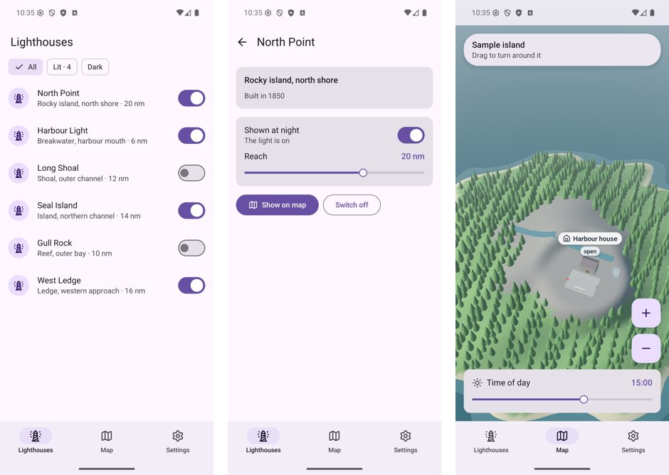

# go-ui on Android

**Status:** a first step (October 2026). A go-ui program opens and draws on an Android 16
emulator, with a 3D scene under its interface, and reacts to taps and drags; the same code runs on
the desktop and in a browser. The example looks like Android's own apps (Material Design 3). This
page started as a plan (what to build, install and try, in which order); *What was built* says how
it turned out, and *Next* what is left.



## What was built

```text
your program            build(context) every frame: the same code as on the desktop
go-ui                   unchanged: context, layout, controls, theme
go-ui/window (android)  window.Run: the interface, and a scene under it, over go-renderer's android
go-renderer/android     the activity, its window and touches, a thread that draws, direct OpenGL ES
go-renderer/gles        FlatRenderer and SceneRenderer, shared with the browser
Android                 its own NativeActivity loads the program, a shared library built with the NDK
```

| Piece | Where |
|---|---|
| The window: renderers made again with each new graphics context, the insets for the interface | `window/android.go` |
| The activity, the drawing thread, touches, JNI for the bars and the theme, crash reports | go-renderer's `android` package ([its docs](../../go-renderer/docs/android.md)) |
| A 3D scene under the interface (`Options.Scene`), on every platform | `window/window.go` and each platform's file |
| An example that looks like an Android app, the same on desktop, web and Android | `cmd/mobile` |
| Building an installable package, with a window theme | `cmd/mobile/build-apk.sh`, `cmd/mobile/android/` |

There is no Java and no golang.org/x/mobile. The first step used x/mobile (gomobile); its way of
calling OpenGL (every call to another thread, three at a time) was about two thirds of what a 3D view
cost on a phone, and go-renderer's own activity halved it (see *A cap on frames*).

**Touch.** The first finger down is the pointer: it moves the cursor and presses the left button,
lifting it releases the button, so every control works unchanged. Other fingers are ignored until
it lifts. Positions are divided by the screen's density, so layout pixels are Android's
density-independent pixels (1/160 inch) and an interface is the same size on every phone.

**Drawing on demand.** As on the desktop and in the browser, the window draws only when something
happens: a touch, a size change, a frame a control asks for (`RequestFrame`) or `window.Wake`. A
frame that would look like the one shown is not drawn. Idle on a phone, the program uses
nothing at all: the drawing thread sleeps until a touch or a frame asked for.

**A cap on frames.** Phones refresh at 90 or 120 Hz, and a finger dragging a 3D view asks for a
frame at every touch event (over a hundred a second). The window draws at most
`Options.MaxFramesPerSecond` frames a second, 60 on a phone by default; the system's own repaints
do not count. Measured on a Pixel 6 Pro dragging the example's island for 10 seconds:
well over a core at first (an independent measurement found 125–128 % at about 100 frames a
second); 82 % with the cap and lighter frames, still through x/mobile; **41 %** with go-renderer's own
activity and direct OpenGL calls.

**The system's bars.** The window covers the whole screen, under see-through bars, as Android's
own apps do. `Context.Insets()` says how much of each edge the status bar and the gesture bar
cover, in layout pixels, so a program paints its own bars' backgrounds under them and keeps its
controls clear. The window asks Android through JNI (`getRootWindowInsets`); before the window is
shown it falls back on the bars' standard heights. The window theme in `cmd/mobile/android/res` makes the bars
see-through, with dark icons in the system's light theme and light ones in its dark theme.

**When it closes on a phone nobody can reach.** On Android the window keeps the report of a crash
(an unrecovered panic, a fatal error or signal, with the failing goroutine's stack) in the
application's own folder, through `runtime/debug.SetCrashOutput`, and `window.LastCrash()` gives it
to the next run; `window.Graphics()` names the phone's OpenGL ES and GPU, or the error that stopped
the window drawing. `cmd/mobile` shows both in its settings, and warns on its first screen after a
crash, so a screenshot is enough to know what happened.

**The dark theme.** `window.SystemPrefersDark()` tells whether the phone (or the browser) is set to
a dark theme, so a program can follow it; `cmd/mobile` asks at every frame until a theme is chosen
in its settings.

**Typing and notifications.** While a text field is typed in (`Context.Typing`), the window brings
the phone's on-screen keyboard up, and puts it away after. `window.Notify` shows a notification in
the phone's shade (in a browser, through the page's notifications), once `window.NotificationsAllowed`;
`window.AskForNotifications` asks the person. On the desktop they are not shown yet.
`window.FeelLongPress` gives the short buzz of a long press (`Context.LongPressed`), where the
person has touch feedback on; in a browser it vibrates where the browser can.

**The wallpaper's colours.** Android 12 and later make five palettes from the wallpaper (Material
You), and the system's own applications take their colours from them. `window.SystemPalettes()`
returns them, thirteen shades each, from white to black (`window.PaletteTones`), and false on an
older phone, on the desktop and in a browser. They change with the wallpaper, so read them at every
frame. go-ui-android's `material.System` builds a Material scheme from them.

**A scene under the interface.** `Options.Scene` returns, at every step, a scene and a camera to
draw behind the interface, or nil for none. It gets the input the interface did not claim, so a
drag on an empty part of the screen turns the camera while a drag on a slider moves the slider.
The scene is drawn by go-renderer's `gles.SceneRenderer` on Android and in browsers, and its
OpenGL scene renderer on the desktop.

**`cmd/mobile`** is built the way Android's own apps look, out of go-ui boxes, texts and
clickables (`material.go`): a top app bar and a navigation bar painted under the system's bars,
list items with a round icon and a Material switch, filter chips, pill-shaped buttons, cards and
floating buttons, in Material Design 3's baseline colours, light and dark, and in Roboto, Android's
typeface (embedded under the SIL Open Font License, in `cmd/mobile/fonts`). Its three destinations
are a list of lighthouses with their details, a map with the 3D island (drag to turn, buttons to
come closer, a slider for the time of day) and settings (the dark theme, the screen's size and
insets).

## Building and trying it

```bash
export ANDROID_HOME=…/android-sdk ANDROID_NDK_HOME=$ANDROID_HOME/ndk/<version>
cmd/mobile/build-apk.sh mobile.apk
adb install -r mobile.apk
adb shell am start -n io.github.akrck02.goui.mobile/android.app.NativeActivity
adb exec-out screencap -p > screen.png          # what the screen shows
adb shell input tap 230 330                     # a tap, in screen pixels
```

`build-apk.sh` builds the program as a shared library with the NDK's compiler (aligned to 16 KB
pages, which newer phones need), and packs it with the Android SDK's tools (`aapt2`, `zipalign`,
`apksigner`) under `cmd/mobile/android/AndroidManifest.xml`: Android's own `NativeActivity`, no Java
code. It signs with the debug key: for trying, not for publishing.

**Installed for this:** the NDK (r29) through `sdkmanager`. The SDK, its build tools, the emulator and
an arm64 Android 16 image were already there.

## What was checked, and what was not

On the emulator (Android 16, arm64, 1080 × 2400 at 420 dots per inch): the window draws with
sharp text at a density of 2.625, clear of the status bar and the gesture bar (49 and 24
layout pixels); a tap on a row opens its details and a tap on its switch flips it without
opening it; the back arrow, the chips, the buttons, the navigation bar and the sliders work; the
island draws at any time of day, turns with a drag and comes closer with the buttons; the dark
theme switches every screen. Idle, the program uses about 0.5 % of a core; the map takes 16 draw
calls a frame.

On a phone (Pixel 6 Pro, Android 16, Mali-G78, 1080 × 2340): the same, in the system's dark theme
at start, and after going to the background and back. That phone gives an OpenGL ES 3.2 context
(first asked for version 2, through x/mobile). It found two faults the emulator hid, now fixed: the 3D map
lost its ground after coming back from the background (meshes kept the buffers of the destroyed
graphics context), and the program read the system's theme before Android gave it.

Not yet: rotating the screen, and how it feels on other phones and tablets.

## Next

| # | What | Why |
|---|---|---|
| 1 | **The bars' icons follow the program's theme**, not only the system's: a JNI call on Android's interface thread | Dark icons on a dark app (when the app's theme differs from the phone's) |
| 2 | **Material pieces in go-ui itself**: a touch theme, the switch, list items, the navigation bar, now in the example | Every program gets them, not only the example |
| 3 | ~~The on-screen keyboard~~ | Done: it comes up while a field is typed in (`Context.Typing`) |
| 4 | ~~Long press~~, **two fingers, the back gesture** | Long press done (`Context.LongPressed`); pinch to zoom the map, back from a lighthouse's details |
| 5 | **Shadows, sky and waves** on phones, as on the desktop | The scene is go-renderer's simple one on phones and in browsers |

## Risks

- **Phones differ.** The window was tried on a Mali GPU (Pixel 6 Pro) and the emulator; an Adreno
  phone closed the first version, for a reason not known yet (the crash report will tell).
- **Battery**: drawing on demand is a must on a phone, and it is in place, with a cap of 60 frames
  a second.
