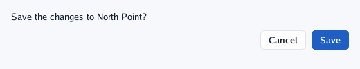
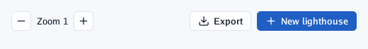
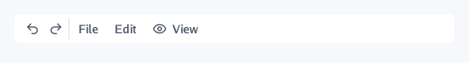
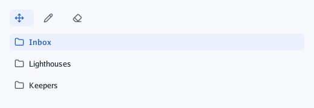
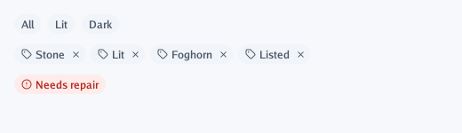
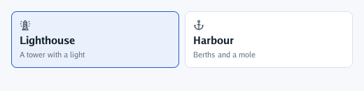

# Buttons

Every button returns `true` **on the frame it is clicked**: a press and a release over it. A
pressed button keeps the pointer until the release, even if it strays; letting go outside is no
click. The pointer turns into a hand over it. A screen reader reads it as "label, button" and can
press it.

## `Button` and `PrimaryButton`

`Button` for ordinary actions, `PrimaryButton` for **the one** main action of a place: Save in a
form, Remove in a sheet that asks first. Put the primary last on the right.

```go
context.Label("Save the changes to North Point?")
context.Row(func() {
	context.Spacer()
	if context.Button("Cancel") {
		// close without saving
	}
	if context.PrimaryButton("Save") { // one primary action per place
		saved++
	}
})
```



When the words change but it is the same button (Switch on, Switch off), keep its id with `##`:
`context.PrimaryButton(label + "##switch")`.

## `IconButton` and `PrimaryIconButton`

An icon before the words, or an icon alone (an empty label makes it square). Use icons alone only
for actions everyone knows (zoom, close, undo), and give them a tooltip.

```go
context.Row(func() {
	if context.IconButton("minus", "") { // square: an icon alone
		zoom--
	}
	context.Label(fmt.Sprintf("Zoom %d", zoom))
	if context.IconButton("plus", "") {
		zoom++
	}
	context.Spacer()
	context.IconButton("download", "Export") // an icon before the words
	context.PrimaryIconButton("plus", "New lighthouse")
})
```



## `FlatButton` and `FlatIconButton`

No fill or border until the pointer is over them: menu bars, toolbars, and actions inside a row
that should not shout.

```go
context.Frame(ui.Layout{Width: ui.Grow(), Padding: ui.PadXY(8, 4), Gap: 2, AlignY: ui.Center},
	ui.Look{Fill: context.Theme.Surface, Radius: 6}, func() {
		context.FlatIconButton("undo-2", "")
		context.FlatIconButton("redo-2", "")
		context.Separator()
		context.FlatButton("File")
		context.FlatButton("Edit")
		context.FlatIconButton("eye", "View")
	})
```



## `Selectable`

An item that shows whether it is chosen, and returns `true` when clicked. In a **row** it fits its
content (a group of tools); in a **column** it takes the whole width (a side list). It does not
change anything itself: your variable decides which one is chosen.

```go
context.Row(func() { // in a row: a group of tools, fitted
	for _, name := range []string{"move", "pencil", "eraser"} {
		if context.Selectable(name, "", tool == name) {
			tool = name
		}
	}
})
context.Column(func() { // in a column: a side list, full width
	for index, name := range []string{"Inbox", "Lighthouses", "Keepers"} {
		if context.Selectable("folder", name, place == index) {
			place = index
		}
	}
})
```



A screen reader reads it as selected or not.

## `Chip` and `RemovableChip`

Small rounded labels: a state, a filter, a tag. `Chip` returns `true` when clicked;
`RemovableChip` has a small × and returns `clicked, removed` apart. `ui.ChipLook{Fill, Ink}` gives
their colours (zero: the theme's quiet ones). To let a row of chips flow onto more lines, put them
in a box with `Wrap: true` and a width that does not follow its content.

```go
context.Row(func() { // filters: click to choose one
	for _, state := range []string{"All", "Lit", "Dark"} {
		look := ui.ChipLook{}
		if filter == state {
			look = ui.ChipLook{Fill: context.Theme.PrimaryTint, Ink: context.Theme.Primary}
		}
		if context.Chip("", state, look) {
			filter = state
		}
	}
})
context.Box(ui.Layout{Width: ui.Grow(), Wrap: true, Gap: 6}, func() { // tags: remove them
	for index := 0; index < len(tags); index++ {
		if _, removed := context.RemovableChip("tag", tags[index], ui.ChipLook{}); removed {
			tags = append(tags[:index], tags[index+1:]...)
			index--
		}
	}
})
context.Chip("circle-alert", "Needs repair", ui.ChipLook{Fill: draw2d.Hex("#fdecea"), Ink: draw2d.Hex("#b3261e")})
```



## `Clickable`

Any box that reacts to the pointer, with its own look while left alone, hovered and pressed. It is
what go-ui's own buttons are made of, and the way to make a card, a row or a tile clickable as a
whole. Buttons inside it keep their own clicks.

```go
theme := context.Theme
cards := []struct{ icon, title, text string }{
	{"lighthouse", "Lighthouse", "A tower with a light"},
	{"anchor", "Harbour", "Berths and a mole"},
}
context.Row(func() {
	for index, card := range cards {
		looks := ui.Looks{
			Normal:  ui.Look{Fill: theme.Surface, Border: theme.Line, BorderWidth: 1, Radius: 8},
			Hovered: ui.Look{Fill: theme.Surface, Border: theme.Primary, BorderWidth: 1, Radius: 8},
			Pressed: ui.Look{Fill: theme.PrimaryTint, Border: theme.Primary, BorderWidth: 1, Radius: 8},
		}
		if index == chosen {
			looks.Normal = looks.Pressed
		}
		layout := ui.Layout{Direction: ui.Vertical, Width: ui.Share(1), Padding: ui.Pad(12), Gap: 4}
		if context.Clickable(card.title, layout, looks, func() {
			context.Icon(card.icon)
			context.Heading(card.title)
			context.Caption(card.text)
		}) {
			chosen = index
		}
	}
})
```



A screen reader reads the texts inside it as a button. If it is something else (a switch, a tab),
say so after it with `context.Describe(ui.Description{Role: …})`.

## `LongPressed`

Tells whether the control added just before it was **held**: a finger still on it for half a
second, or the right mouse button. A touch that became a long press is no click. Use it for a
second action on the same thing: choosing rows, a context menu.

```go
if context.Selectable("file", name, chosen[name]) {
	open(name)
}
if context.LongPressed() {
	chosen[name] = true // start choosing several
}
```

---

[← Text, icons and pictures](text.md) · [Choices →](choices.md)
