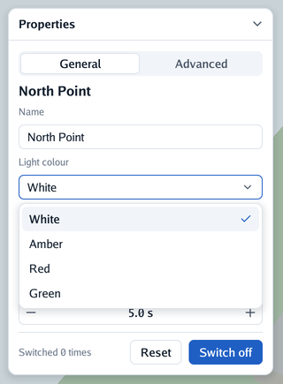
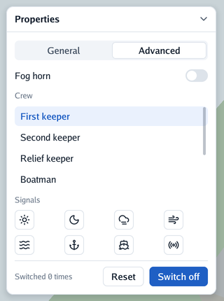

# 🎛️ Controls

Every control is a function call that adds a box and, for those you can act on, tells you what
happened in this frame. Controls added inside a [panel](panels-and-layers.md) go in it; added
outside any panel, they go on the **screen**.

<table>
<tr>
<th width="50%">Fields, a select and buttons</th>
<th width="50%">A switch, a scrolling list and a grid</th>
</tr>
<tr>
<td align="center">
<picture>
  <source media="(prefers-color-scheme: dark)" srcset="images/panel-dark.png">
  
</picture>
</td>
<td align="center">
<picture>
  <source media="(prefers-color-scheme: dark)" srcset="images/advanced-dark.png">
  
</picture>
</td>
</tr>
<tr>
<td><code>Tabs</code>, <code>Heading</code>, <code>TextField</code>, <code>Select</code> open, <code>Button</code> and <code>PrimaryButton</code> (<code>cmd/example</code>).</td>
<td><code>Toggle</code>, <code>ListBox</code>, <code>Grid</code> of <code>IconButton</code>s (<code>cmd/example -advanced</code>).</td>
</tr>
</table>

## Text and icons

| Control | What it does |
|---|---|
| `Label(text)`, `Heading(text)`, `Caption(text)`, `Text(text, style)` | Lines of text: body, bold title, small hint, or any size, weight and colour |
| `Icon(name)`, `IconSized(name, size, colour)` | A [Lucide](https://lucide.dev/icons) icon |
| `Image(picture, layout, radius)` | A picture (`draw2d.Image`) filling a box of the size given, cropped evenly where their shapes differ, its corners rounded |

## Buttons

| Control | What it does |
|---|---|
| `Button(label)`, `PrimaryButton(label)`, `IconButton(icon, label)` | Return `true` on the step they are clicked; an icon button with an empty label is square |
| `FlatButton(label)`, `FlatIconButton(icon, label)` | Buttons with no fill or border until hovered: menu bars and toolbars |
| `Selectable(icon, label, selected)` | An item that shows whether it is selected and returns `true` when clicked: full width in a column (a side list), fitted in a row (a group of tools) |
| `Clickable(name, layout, Looks{…}, content)` | Any box that reacts to the mouse, with its own looks when left alone, hovered and pressed: the building block for controls of your own, like a table row |
| `MenuButton(icon, label, content)`, `MenuItem(icon, label, hint)` | A flat button that opens a menu under it; see [menus](panels-and-layers.md#menus) |

## Choices and values

| Control | What it does |
|---|---|
| `Checkbox(label, &value)` | A box to tick, with its label; clicking either flips the value. Returns `true` when it changes |
| `Toggle(label, &value)` | A settings row: the label on the left, a switch on the right |
| `Slider(name, &value, minimum, maximum)`, `SliderStep(…, step)` | A track with a knob: click to jump, drag to slide, Shift to slide ten times slower; `SliderStep` keeps whole steps |
| `NumberField(name, &value, minimum, maximum, step, format)` | A number with − and + on its sides; drag the number sideways for a step every 4 px, or click it to type a value (a point or a comma for decimals; Enter keeps it, Escape does not). Shown with a format such as `"%.1f s"` |
| `Tabs(name, &selected, labels…)` | A segmented row, the selected segment raised; the program shows what belongs to it with an `if` |
| `Select(name, &selected, options)` | A field showing the chosen option; clicking opens the list over everything. Click an option, or use the arrows and Enter; Escape or a click elsewhere closes it |
| `TextField(name, &text)`, `TextFieldWith(name, &text, TextFieldOptions{…})` | A line of text to type in, with a `Placeholder`, a `MaxLength` or a `Width`, `Secret` for a password (a dot for each character, nothing copied). Returns `true` on the steps the text changes; see [text fields](text-fields.md) |
| `FieldFocused(name)`, `FocusField(name)` | Whether the field of a name has the keyboard (for a box the program draws around it), and giving it the keyboard (a search that opens ready to type in) |

## Lists and scrolling

| Control | What it does |
|---|---|
| `ScrollArea(name, layout, content)` | Content that scrolls when taller than the box: wheel or trackpad over it, or drag the thin bar on its right |
| `List(name, layout, count, rowHeight, row)` | A scroll area of equal rows that builds only the rows in sight: ten thousand rows cost what twenty do |
| `ListBox(name, layout, items, &selected)` | A scrolling list of selectable items |
| `Table(name, layout, columns, rows)` | A header and rows that scroll, with group captions and a selected row; see [tables](tables-and-dragging.md#tables) |

## Rows, columns and grids

| Control | What it does |
|---|---|
| `Row(content)`, `Column(content)` | Shortcuts for full-width boxes with the theme's gap; a row centres its children vertically |
| `Spacer()` | Takes the free space of its row or column, pushing what follows to the end |
| `Separator()` | A thin line across its row or column |
| `Grid(columns, content)` | Rows of equal cells (or any box with `Layout.Columns`) |
| `Box(layout, content)`, `Frame(layout, look, content)` | Any box, arranged or also painted; see [layout](layout.md) |

## Chips, notes and gestures

| Control | What it does |
|---|---|
| `Chip(icon, label, ChipLook{Fill, Ink})` | A small rounded label (a tag, a state) in colours of your choice (zero = the theme's quiet ones); returns `true` when clicked |
| `RemovableChip(icon, label, look)` | A chip with a small ×: returns `clicked, removed` apart |
| `Tooltip(text)` | Explains the control added just before it, in a small dark note, once the pointer rests on it for half a second |
| `LongPressed()` | Tells whether the control added just before it was long-pressed in this frame: a finger held still on it for half a second, or the right mouse button. A touch that became a long press is no click |
| `Popover(name, &open, look, content)` | A box of the program's own floating under the control added just before it (a dropdown's choices); a touch outside, Escape or the back closes it |

## Panels, sheets, dragging and resizing

These have pages of their own, [panels and layers](panels-and-layers.md) and
[tables, dragging and resizing](tables-and-dragging.md):

| Control | What it does |
|---|---|
| `Panel(title, content)`, `PanelWith(title, PanelOptions{…}, content)` | A floating card with a title bar, moved, folded, placed, sized, locked or docked; see [panels](panels-and-layers.md#panels) |
| `Sheet(title, SheetOptions{Width}, content)` | A modal card in the middle of the window; returns `true` when the person asks to close it. See [sheets](panels-and-layers.md#sheets) |
| `DragSource(name, payload, layout, content)`, `DropTarget(name, layout, accepts, content)` | Drag a value of yours from one box to another, or onto the scene; see [drag and drop](tables-and-dragging.md#drag-and-drop) |
| `Resizable(name, side, &size, minimum, maximum, layout, content)` | A box whose edge can be dragged to change its width or height; see [resizable boxes](tables-and-dragging.md#resizable-boxes) |

## Painting and motion

| Call | What it does |
|---|---|
| `Context.Paint` | Adds a box the program paints itself once laid out, for shapes go-ui has no control for |
| `Context.Animate` | Eases a value to its target, asking for frames only while it moves |
| `Context.Appear` | Eases something in as it is shown |
| `Context.Fold` | Opens a box to its content's height and closes it to nothing, with motion (more under a list row) |
