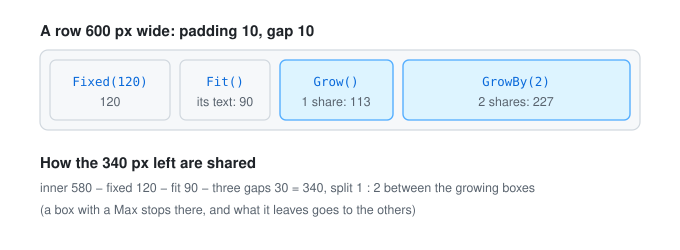
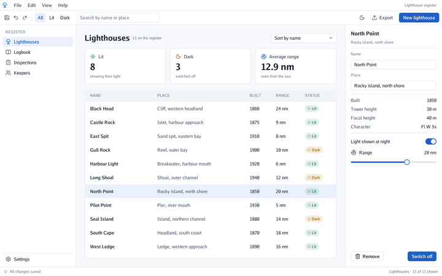

# 📐 Layout

Every control is a **box**, and boxes nest. Layout happens in `End`, once the whole tree is
known, so a box can grow into space that depends on boxes declared after it.

<p align="center">
  
</p>

## Asking for a layout

A box's `Layout` says:

| Field | Meaning |
|---|---|
| `Direction` | `Horizontal` (children left to right, the default) or `Vertical` (top to bottom) |
| `Width`, `Height` | `Fit()` (as big as the content, the default), `Grow()` / `GrowBy(weight)` (the content plus a share of the free space), `Share(weight)` (a share of the free space, starting from nothing: equal shares come out equal, so table columns line up), `Fixed(pixels)`, `Percent(share)`; `.Between(min, max)` bounds any of them |
| `Padding` | Space inside the edges: `Pad(all)`, `PadXY(horizontal, vertical)` or each side |
| `Gap` | Space between children |
| `AlignX`, `AlignY` | `Start`, `Center` or `End`: where children sit when there is room to spare |
| `Columns` | Above 0, a grid: children fill rows of this many equal cells, with `Gap` both ways |
| `Wrap` | On a horizontal box, children that would pass the right edge go on to a new line, like words (a row of tags); give the box a width that does not follow its content (`Grow` in a column, `Fixed`) |

```go
interfaceContext.Box(ui.Layout{Direction: ui.Vertical, Width: ui.Grow(), Gap: 8}, func() { … })
interfaceContext.Frame(layout, ui.Look{Fill: theme.Surface, Border: theme.Line, BorderWidth: 1, Radius: 6}, func() { … })
```

`Box` only arranges; `Frame` also paints a fill, a border, rounded corners, a shadow or a clip
(`Look`). Because layouts and looks are plain structs, they can come from a file one day, like a
theme.

When a fill and a border are not enough, `Look.Backdrop` draws the rest of a box's background
itself: anything with a `Paint(area, drawing)` method, called under the box's children. A
pixel-art window (an outline, a frame of two colours, corners cut a pixel at a time) or a
patterned panel is a backdrop. Keep one value of it and point every look at it, so a frame
allocates nothing. Text can carry a hard shadow the same way pixel-art games draw it:
`TextStyle{Shadow: colour}` draws it a pixel right and down, under the text.

## How sizes are worked out

The work is done one axis at a time:

1. **Fit**, from the leaves up: a text is as wide as it measures, an icon as its size; a box adds
   up its children along its direction (plus gaps) or takes the biggest across it, plus padding.
2. **Grow**, from the root down: percentages take their share of the parent; along the
   direction, growing children split the space left in proportion to their weights; across it,
   they take the parent's size. When the content does not fit (a narrow window), the growing
   children **shrink** instead, each giving up part of what it has above its minimum, so fixed
   and fitted boxes around them (a side column, an inspector, a button) keep their size.
3. **Place**, from the root down, with padding, gaps and alignment.

Text does not wrap yet, so heights never depend on widths, except in a box with `Wrap`: its height is
worked out once the widths are known, which the axis-by-axis order allows. Content that still does not fit
overflows at the end and is cut by the panel. A line of text in a box whose look clips
(`Look{Clip: true}`, like a table cell) ends in "…" where it would pass the box's edge.

## A whole application

The same boxes lay out a whole window. Here the register (`cmd/app`) is a column of a menu bar, a
toolbar and a row; the row holds a fixed navigation list, a growing middle (cards in `Share`
columns over a table) and a fixed inspector. Narrow the window and only the middle shrinks.

<p align="center">
<picture>
  <source media="(prefers-color-scheme: dark)" srcset="images/hero-dark.png">
  
</picture>
</p>

Shortcuts for the common cases (`Row`, `Column`, `Spacer`, `Separator`, `Grid`) are in the
[controls](controls.md#rows-columns-and-grids).
