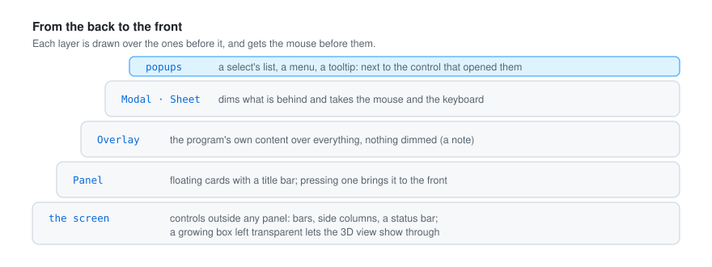
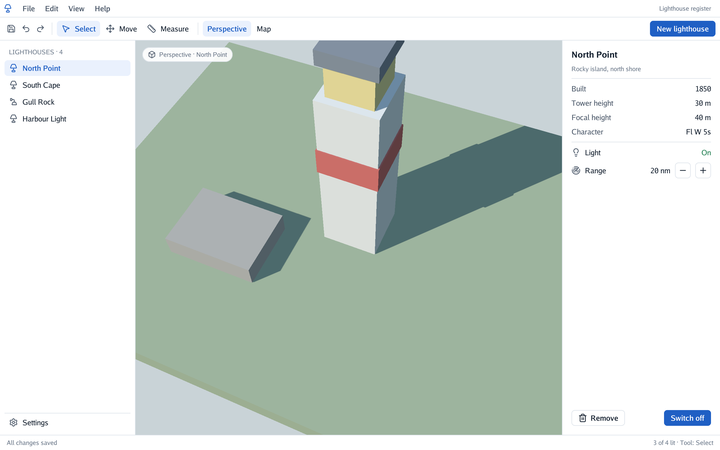
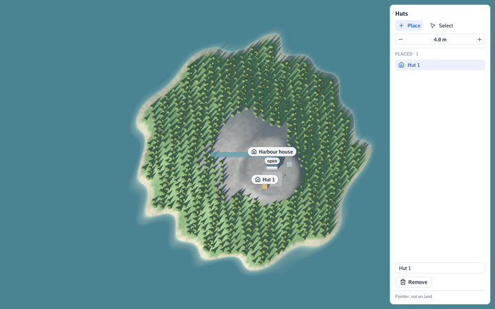
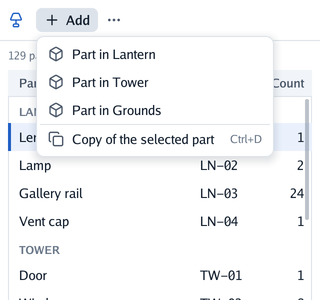
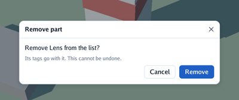
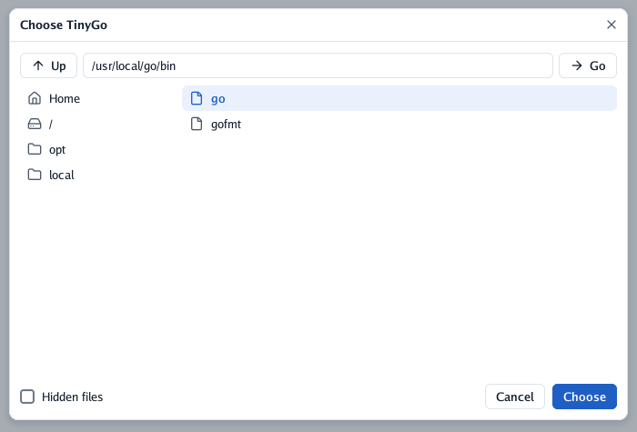

# 🗂️ Panels and layers

An interface is made of layers, drawn one over another. What is in front is drawn last and gets
the mouse first.

<p align="center">
  
</p>

## Panels

| Control | What it does |
|---|---|
| `Panel(title, content)` | A floating card with a title bar: drag the bar to move it, the chevron folds it. Pressing a panel brings it to the front. |
| `PanelWith(title, PanelOptions{…}, content)` | The same, placed (`X`, `Y`), sized (`Width`, `Height`), `Locked`, or docked to an edge (`DockLeft`, `DockRight`, `DockTop`, `DockBottom`) |

Panels open a scope with their title, so controls with the same label in two panels stay apart
([ids and scopes](getting-started.md#ids-and-scopes)).

## The screen

Controls added outside any panel go on the **screen**, a box the size of the window behind every
panel: a status bar is a `Spacer()` followed by a full-width `Frame`. The screen can hold a whole
application layout: boxes painted with a fill there (bars, side columns) take the mouse like
panels do, and a growing box left transparent lets a 3D view show through, with the camera
working inside it (`cmd/scene-app`).

<p align="center">
<picture>
  <source media="(prefers-color-scheme: dark)" srcset="images/scene-app-dark.png">
  
</picture>
</p>

### Editing the scene it shows

A program that **edits** the scene it shows runs through go-renderer's `viewer.Edit`: the
interface is built in its function, and `viewer.View` turns the pointer into a point on the ground.
`cmd/plan-editor` places huts on an island by clicking on the map (a drag still moves the map),
and a panel lists them to select, rename and remove; at rest it uses no processor or GPU.

<p align="center">
<picture>
  <source media="(prefers-color-scheme: dark)" srcset="images/plan-editor-dark.png">
  
</picture>
</p>

## Popups

The list of a select, a menu and a tooltip are **popups**: boxes that float over everything, next to the
control that opened them, under it or above it when there is no room below. Popups are drawn above
every panel and get the mouse before them. An open select also takes the keyboard (for its arrows)
until it closes. `Popover` makes a popup of the program's own ([controls](controls.md#chips-notes-and-gestures)).

## Menus

<p align="center">
<picture>
  <source media="(prefers-color-scheme: dark)" srcset="images/menu-dark.png">
  
</picture>
</p>

```go
context.MenuButton("plus", "Add", func() {
	if context.MenuItem("box", "Hut", "") { addHut() }
	context.Separator()
	if context.MenuItem("copy", "Copy", "Ctrl+D") { copySelected() }
})
```

The menu is a popup, like a select's list: it opens under its button, or above it when there is
no room. Items are chosen with a click, or with the arrows and Enter; choosing closes it, and so
do Escape and a click anywhere else. While it is open it holds the keyboard. The hint is drawn
quietly on the right: the text of a shortcut, which the program handles itself.

## Sheets

<p align="center">
<picture>
  <source media="(prefers-color-scheme: dark)" srcset="images/sheet-dark.png">
  
</picture>
</p>

```go
if confirming && context.Sheet("Remove part", ui.SheetOptions{}, func() {
	context.Label("Remove the lens from the list?")
	if context.PrimaryButton("Remove") { removeLens(); confirming = false }
}) {
	confirming = false // Escape, the × or a click on the dimmed backdrop
}
```

A sheet is shown with an `if`, as long as the program wants. It dims everything behind it and
takes the mouse and the keyboard: nothing behind reacts, a field behind loses the focus when the
sheet opens, Tab goes round the sheet's own fields, and `End` claims both, so cameras and shortcuts
keep still. It returns `true` on the step the person asks to close it: Escape (unless a field, a
select or a menu inside it takes Escape first), the × in its title or a click on the backdrop.
`SheetOptions.Width` sizes the card (420 px by default). Popups (a select inside the sheet) open
over it. The dimming colour is the theme's `Scrim`.

## Choosing a file

A file picker is a sheet made for one question: which file, or which folder? Its left column has
places to start from (the home folder, the disk's root, and the folders the program offers), the
right one what the folder open holds, folders first, and the row above the folder's path, to go up
or type a path straight in.

<p align="center">
  
</p>

```go
if picking {
	path, closed := context.FilePicker(ui.FilePickerOptions{
		Title:    "Choose a model",
		Start:    modelPath,         // opens beside the file chosen before
		Suffixes: []string{".glb"},  // the folders always show, to go through them
		Places:   []string{"/opt"},
	})
	if closed {
		picking = false
		if path != "" {
			modelPath = path
		}
	}
}
```

A click on a folder goes into it. A click on a file chooses it, and a second click, or
**Choose**, ends the picker with it; **Cancel**, Escape or the backdrop end it with nothing. With
`Folder: true` it chooses a folder instead: **Choose** takes the one open, and files are not shown.
Hidden files (a dot first) show only when asked. It is drawn like every other control, so it looks
the same on every system and asks nothing of the system's own dialogs. `ReadFolder` lets a test
give it a folder of its own.

## Modals and overlays

`Context.Modal` and `Context.Overlay` put a program's own content over everything, dimming what is
behind (a dialog) or not (a note at the bottom). A modal covers the overlays, as a dialog or a
drawer covers a phone's floating buttons: they are not touched nor read while it is open. With
`LayerOptions.Leave` they leave with motion once the program stops showing them, fading and moving
away (a picture of their last frame, which cannot be touched).

`Context.Back` answers a phone's back gesture; modals and sheets answer it first.
