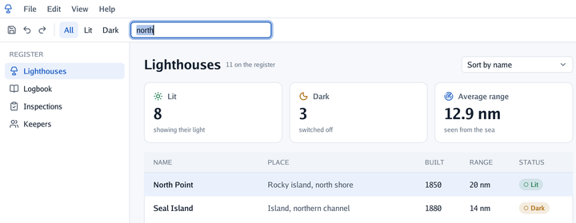

# ⌨️ Text fields

A text field edits your string as it is typed: `TextField("Name", &entry.name)` changes
`entry.name` on the step a key is pressed, and returns `true` then.

<picture>
  <source media="(prefers-color-scheme: dark)" srcset="images/search-dark.png">
  
</picture>

`go run ./cmd/app -demo-search north` types in the search box on its second step, as above.

## Keys

| To | Do |
|---|---|
| Place the caret | Click; Shift-click selects up to there |
| Select | Drag; double-click for a word, triple-click for the whole text |
| Move | Arrows; with Alt on a Mac or Ctrl elsewhere, a word at a time; Home and End (or Cmd+arrows on a Mac) to the ends. Shift selects as it moves |
| Delete | Backspace and Delete; a word with Alt (Mac) or Ctrl |
| Copy, cut, paste, select all | Cmd on a Mac or Ctrl elsewhere, with C, X, V, A |
| Undo, redo | Cmd/Ctrl+Z, and Shift+Cmd/Ctrl+Z or Cmd/Ctrl+Y. Typing a run of letters, or of Backspaces, is undone in one step; each field keeps its own history while it has the focus |
| End the edit | Enter, or a click anywhere else; Escape puts back the text the field had when it took the focus |
| Go to the next field | Tab, or Shift+Tab to go back; it goes round, includes number fields, and selects the text it lands on |

Characters come from the system after the keyboard layout and dead keys, so accents and «ñ» type
as anywhere else. Line breaks and tabs pasted in become spaces: the field has one line. Text
longer than the field slides sideways to keep the caret in sight.

## Focus

`Focus(path…)` gives the keyboard to a field by its scopes and label, as `Area` finds it, with its
text selected: the search box on a shortcut, or the first field of a form that just opened. While
a field has the focus, `End` claims the keyboard, so the viewer's shortcuts and cameras do not
take the letters. By the field's name instead, `FieldFocused(name)` tells whether it has the keyboard and
`FocusField(name)` gives it the keyboard.

## On a phone

A phone's on-screen keyboard edits the field's text rather than typing key by key: it suggests
words, keeps the word it is still making underlined (*composing*) and deletes around the caret.
`TypedField()` tells the window which field is typed in, with its text, selection and composing
word, and `EditTypedField(edit)` puts the keyboard's edit in, in the next frame, as typing: one
line, cut at `MaxLength`, its words undone as typed ones are. A key or a touch that changes the
text ends the composing. The Android window does both ([Android](android.md)).

On a touch screen, text is chosen as on a phone. A finger held on a word selects it: a drop-shaped
handle hangs under each end of the selection, and a bar over it offers *Cut*, *Copy*, *Paste* and
*Select all* (`SetEditingWords` in the person's language, `EditingWords` to read them; a secret
field cannot be cut or copied).
A touch shows a handle under the caret. A finger drags a handle to move its end, or the caret; the
handle hangs under the text, so the finger does not hide what it chooses, and the ends never cross.
The handles and the bar are popups of the field's own: pressing them keeps the field typed in.
Typing, on either keyboard, puts them away; a mouse has none.
