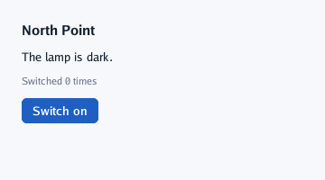
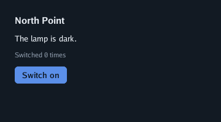

# Lesson 1: immediate mode

In this lesson you write the smallest useful go-ui program, a lamp that is switched on and off, and
learn the one idea everything else rests on: **the interface is a function of your data, called
again at every frame**.

## A frame

```go
// The first go-ui program: a lighthouse whose lamp is switched on and off, counting the switches.
package main

import (
	"flag"
	"fmt"
	"log"

	ui "github.com/akrck02/go-ui"
	"github.com/akrck02/go-ui/window"
)

func main() {
	options := window.Options{Title: "Lighthouse"}
	options.RegisterFlags(flag.CommandLine) // -capture, -dark, -width, -height…
	flag.Parse()

	lit := false // the program's own data: go-ui keeps none of it
	switches := 0

	build := func(context *ui.Context) {
		context.Box(ui.Layout{Direction: ui.Vertical, Width: ui.Grow(), Padding: ui.Pad(24), Gap: 12}, func() {
			context.Heading("North Point")
			if lit {
				context.Label("The lamp is lit.")
			} else {
				context.Label("The lamp is dark.")
			}
			context.Caption(fmt.Sprintf("Switched %d times", switches))

			label := "Switch on"
			if lit {
				label = "Switch off"
			}
			if context.PrimaryButton(label + "##switch") {
				lit = !lit
				switches++
			}
		})
	}
	if err := window.Run(options, build); err != nil {
		log.Fatal(err)
	}
}
```

 

Read `build` from top to bottom, as go-ui does at every frame:

1. A **box** that stacks its children vertically, as wide as the window, with 24 pixels of
   padding and 12 between children. Boxes are the only way go-ui arranges things ([lesson 2](02-layout.md)).
2. A heading, then one of two lines, chosen with an ordinary `if`.
3. A caption with the count, formatted from your variable.
4. A button. `PrimaryButton` draws it in the theme's primary colour and returns `true` **on the
   frame it is clicked**: that is where you change your data.

There is no `OnClick`, no button object, no "update the label" step. The next frame calls `build`
again, which reads `lit` and `switches` again, and the screen follows.

> 📝 **When is `build` called?** Whenever something could have changed: input, a resize, a frame a
> control asks for (a caret's blink). In between, the window sleeps and the program uses no
> processor. From another goroutine (a download finished) call `window.Wake()`.

## Ids: how go-ui tells controls apart

go-ui keeps a little state between frames: which control is pressed, which field has the keyboard,
where a list is scrolled. It finds it again by each control's **id**, a hash of its label and the
**scopes** around it.

- The button's label changes, "Switch on" or "Switch off", but it must stay the same button (or a
  press that started on one would end on another). Everything after `##` is part of the id but not
  shown: `"Switch on##switch"` and `"Switch off##switch"` are one button.
- Two buttons both called "Remove" in a loop would share an id. Open a scope per item with
  `context.Push(name)` and close it with `context.Pop()`; you will do it in [lesson 3](03-controls-and-forms.md).
- Panels open a scope with their title, so "Apply" in two panels never mixes.

## The text controls

| Call | Draws |
|---|---|
| `Heading(text)` | A bold title |
| `Label(text)` | Body text |
| `Caption(text)` | Small, quiet text: hints and counts |
| `Text(text, ui.TextStyle{Size, Weight, Color})` | Any size, weight (`draw2d.Regular`, `Medium`, `Bold`, `Mono`) and colour |
| `Icon(name)` | A [Lucide](https://lucide.dev/icons) icon by name |

## What you learnt

- `window.Run` calls your function at every frame; it describes the whole interface.
- Controls are function calls that return what happened; your variables hold the state.
- Ids come from labels and scopes; `##` keeps an id while the words change.

## Practice

Add a second button, "Reset", that sets the count back to zero, and show it only once the lamp has
been switched at least once.

<details>
<summary>Solution</summary>

```go
if switches > 0 && context.Button("Reset") {
	switches = 0
}
```

Showing a control is an `if`; when the condition is false the button simply is not described, so
it is not there.

</details>

---

[← Tutorial](README.md) · [Lesson 2: layout →](02-layout.md)
