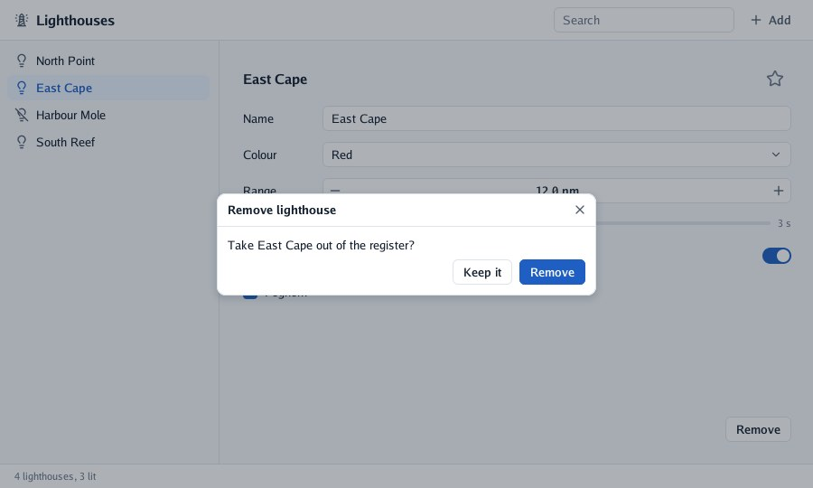

# Lesson 4: menus, sheets and notes

A register needs to grow and shrink. In this lesson you add lighthouses from a **menu**, ask before
removing one with a **sheet**, and confirm it with a short **note** (a toast).

| Mission | Pieces | Time |
|---|---|---|
| Adding and removing lighthouses | `MenuButton`, `Sheet`, `Toast` | 15 min |

#### The idea

A sheet is a **clerk who asks before stamping**: while it is open, nothing else on the desk can be touched. It stays exactly as long as your program says (an `if`), and tells you when the person waves it away.

## A menu

`MenuButton(icon, label, content)` is a flat button that opens a menu under it. Its content is
described only while it is open; `MenuItem` returns `true` when chosen, and choosing closes it.
Arrows and Enter work, and Escape or a click elsewhere closes it. It goes at the end of the
toolbar, after the search box:

```go
context.MenuButton("plus", "Add", func() {
	if context.MenuItem("lighthouse", "Lighthouse", "") {
		program.add()
	}
	if context.MenuItem("copy", "Copy of the selected one", "") && program.selected >= 0 {
		program.lighthouses = append(program.lighthouses, program.lighthouses[program.selected])
		program.selected = len(program.lighthouses) - 1
	}
})
```

The third argument of `MenuItem` is a hint drawn quietly on the right, such as `"Ctrl+N"`: the
program handles the shortcut itself (`state.Pressed`), go-ui only shows it.

```go
func (program *register) add() {
	program.added++
	program.lighthouses = append(program.lighthouses, lighthouse{name: fmt.Sprintf("New lighthouse %d", program.added), rangeNM: 10, period: 5})
	program.selected = len(program.lighthouses) - 1
	program.search = ""
}
```

## A sheet that asks first

A **sheet** is a modal card in the middle of the window. Like everything else it is shown with an
`if`, for as long as your program wants: here, while `program.removing` is true. It dims what is
behind it and takes the mouse and the keyboard, so nothing behind reacts.

```go
// confirmRemoval asks before a lighthouse is taken out of the register.
func (program *register) confirmRemoval(context *ui.Context) {
	if !program.removing {
		return
	}
	name := program.lighthouses[program.selected].name
	dismissed := context.Sheet("Remove lighthouse", ui.SheetOptions{}, func() {
		context.Label(fmt.Sprintf("Take %s out of the register?", name))
		context.Row(func() {
			context.Spacer()
			if context.Button("Keep it") {
				program.removing = false
			}
			if context.PrimaryButton("Remove") {
				program.remove()
				context.Toast(name+" was removed", false)
			}
		})
	})
	if dismissed {
		program.removing = false
	}
}

func (program *register) remove() {
	program.lighthouses = append(program.lighthouses[:program.selected], program.lighthouses[program.selected+1:]...)
	program.selected = min(program.selected, len(program.lighthouses)-1)
	program.removing = false
}
```

`Sheet` returns `true` on the frame the person asks to close it some other way: Escape, the × in
its title, or a click on the dimmed backdrop. Your program decides what that means; here, the same
as "Keep it".

`confirmRemoval` is called **after** the rest of the window in `build`, so the sheet is described
last and drawn over it.



## A note that goes away

`Toast(text, warning)` shows a short note at the bottom of the window for a few seconds. Unlike
everything else it is *fired once*, not described at every frame: go-ui keeps it until it fades.

## More layers

| Call | Shows |
|---|---|
| `Sheet(title, options, content)` | A modal card with a title and a ×; returns `true` when dismissed |
| `Modal(name, LayerOptions{…}, content)` | Your own content over everything, dimming what is behind (a dialog, a drawer) |
| `Overlay(name, LayerOptions{…}, content)` | Your own content over everything, without dimming (a note, a floating button) |
| `Popover(name, &open, look, content)` | A box floating under the control before it (a dropdown of your own) |
| `Tooltip(text)` | A dark note explaining the control before it, after the pointer rests on it |
| `Toast(text, warning)` | A short note at the bottom, fired once |

`LayerOptions.Leave` makes a modal or an overlay leave with motion once you stop showing it.

#### Checkpoint

*Add* opens a menu that adds a lighthouse; *Remove* dims the window under a sheet that asks first; *Remove* in it takes the lighthouse out and a note says so.


## What you learnt

- A menu's content is described only while open; `MenuItem` returns `true` when chosen.
- A sheet is shown with an `if`, and returns `true` when the person dismisses it.
- What is described later is drawn on top; toasts are fired once.

## Bonus (optional)

Give the Remove button a tooltip, "Takes it out of the register, after asking", and show the
"Copy of the selected one" item only when a lighthouse is selected.

<details>
<summary>🔓 Show the solution</summary>

```go
if context.Button("Remove") {
	program.removing = true
}
context.Tooltip("Takes it out of the register, after asking")
```

```go
if program.selected >= 0 && context.MenuItem("copy", "Copy of the selected one", "") {
	…
}
```

`Tooltip` explains the control added just before it.

</details>

---

[← Lesson 3](03-controls-and-forms.md) · [Lesson 5: controls of your own →](05-controls-of-your-own.md)
