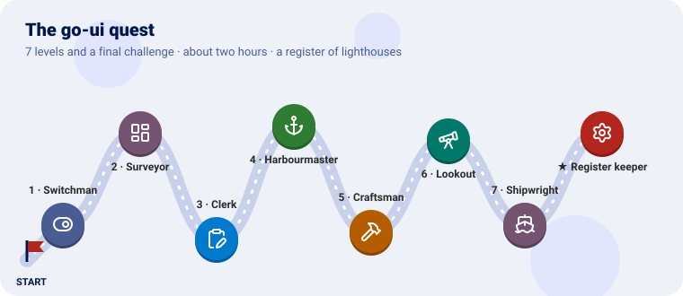
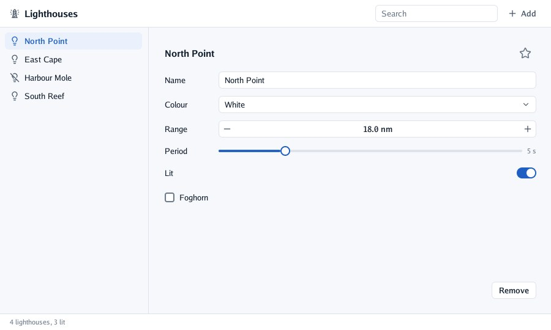

# Tutorial: a register of lighthouses

In seven lessons you build a real desktop application, one step at a time: a register of
lighthouses with a list to choose one, a form to edit it, a search, a menu, a sheet that asks
before removing, and a control of your own. Then you put an interface over a 3D scene, and take
the program to a web page and a phone.

**Before you start**, follow [Get started](../get-started.md). Each lesson takes ten to twenty
minutes and ends with something you can run.

Every lesson has the same shape, as in a quest: **the idea** in everyday words, **the code**, a **checkpoint** to know it works, a **bonus** with its solution folded, and an **achievement** to unlock. A final challenge waits at the end of lesson 7.

| Lesson | You learn | You end with |
|---|---|---|
| [1. Immediate mode](01-immediate-mode.md) | A frame, controls that return what happened, ids and scopes | A lamp to switch on and off |
| [2. Layout](02-layout.md) | Boxes, directions, `Fit`, `Grow`, `Fixed`, padding, gaps, frames | The window's skeleton: toolbar, side list, content, status bar |
| [3. Controls and forms](03-controls-and-forms.md) | Selectable rows, text and number fields, selects, sliders, toggles | A form that edits the lighthouse chosen |
| [4. Menus, sheets and notes](04-menus-sheets-and-notes.md) | Menus, modal sheets, toasts, the search | Adding and removing lighthouses |
| [5. Controls of your own](05-controls-of-your-own.md) | `Clickable`, looks, `Describe` for screen readers, `Paint`, themes | A favourite star, and a theme of your own |
| [6. Over a 3D scene](06-over-a-3d-scene.md) | go-ui with go-renderer's viewer, claims, `Options.Scene` | A panel that moves the sun over an island |
| [7. Shipping it](07-shipping-it.md) | Preferences, leaving the screen, the web, Android | The register in a browser and on a phone |

Lessons end with **practice**, with a solution folded under it. The complete program is at the end
of [lesson 5](05-controls-of-your-own.md#the-whole-program).

> 💡 Every program here takes `-capture shot.png` (one frame to a picture), `-dark`, `-width` and
> `-height`, through `window.Options.RegisterFlags`. That is how the pictures were made.

---

[← Get started](../get-started.md) · [Lesson 1 →](01-immediate-mode.md)
